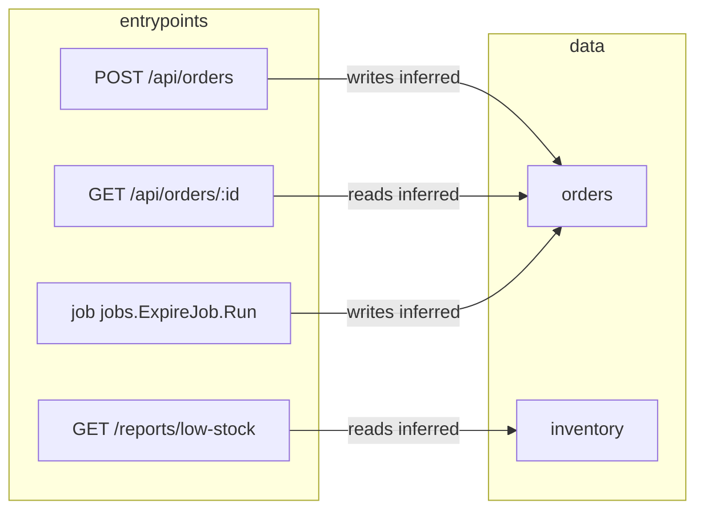

# BizMap

**Deterministic** business-rule and data-lineage map for a codebase.

For each database table and column, BizMap answers:

- **who writes it** (function / repository method)
- **triggered by what** (HTTP route, scheduled job, DB trigger, queue, Firestore)
- **in which situation** (the comment or docstring already sitting above that function, plus const/iota arguments when seen)
- **who reads it**

Output is a graph (`bizmap.graph.json`) that AI tools can query later (MCP in a
future version) and that will power PR conflict warnings (also later).

BizMap **does not call an LLM**. No tokens, no accounts, no “guess the business
rule”. SQL is parsed with [sqlglot](https://github.com/tobymao/sqlglot)
(PostgreSQL dialect). Code is parsed with [tree-sitter](https://tree-sitter.github.io/).
Frameworks are declared in YAML so the community can add Echo, FastAPI, Express,
… without changing the engine. Findings carry a confidence of `exact`,
`inferred`, or `unknown` (for example dynamically built SQL like
`"UPDATE t SET " + col`). Anything the scanner cannot see can be completed in a
`bizmap.yaml` overrides file.

## Quickstart

Python 3.11+:

```bash
pip install -e ".[dev]"
bizmap scan examples/shop --mermaid
bizmap why orders.status
bizmap scan examples/pyplatform --mermaid
```

With [uv](https://astral.sh/uv):

```bash
uv sync --extra dev
uv run bizmap scan examples/shop --mermaid
uv run bizmap why orders.status
```

`scan` writes `bizmap.graph.json` (and `bizmap.graph.mmd` with `--mermaid`).
`why TABLE.COLUMN` prints writers, readers, and the entrypoints that trigger them.

`--mermaid` is an **entrypoint → table** rollup (readable on large apps).
A joint / multi-repo scan also draws **`calls_http` between services**,
one subgraph per repo. Use `--mermaid-focus orders` for the neighborhood
of one table, and
`--expand-star` only if you want `SELECT *` expanded to schema columns at the
SQL origin.

`bizmap.yaml` is loaded from `--config path`, else the scan root, else the
git toplevel. `exclude` globs skip seed/demo trees inside the scan root;
`--exclude GLOB` (repeatable) merges with the YAML list. `--profile` prints
parse / resolve / sql / propagate timings to stderr.

Scan several service roots at once, or merge graphs later:

```bash
bizmap scan examples/pyplatform/catalog examples/pyplatform/storefront --out merged.json
bizmap registry merge a.json b.json --out merged.json
bizmap why orders.status --graph merged.json
```

   `name` / `database` / `services` / `repos` / `constants` in `bizmap.yaml`
control repo-qualified ids, shared table ids, HTTP base-URL matching, and
unscanned package const aliases (`PathPrefix`, `pkg.Name`).

### Example `why` output

```
column: orders.status (TEXT)

writers:
  [exact] repository.Repo.InsertOrder  (repository/repository.go:112 repository.Repo.InsertOrder)
      triggered by HTTP POST /api/orders — CreateOrder records a paid checkout and reserves inventory.
  [exact] repository.Repo.ExpirePendingOrders  (repository/repository.go:148 repository.Repo.ExpirePendingOrders)
      triggered by scheduled job jobs.ExpireJob.Run — Run expires unpaid checkout sessions so reserved inventory can be released.
  [inferred] handlers.Handler.CreateOrder  (handlers/handlers.go:41 handlers.Handler.CreateOrder)
      triggered by HTTP POST /api/orders — CreateOrder records a paid checkout and reserves inventory.

readers:
  [exact] repository.Repo.GetOrder  (repository/repository.go:129 repository.Repo.GetOrder)
      triggered by HTTP GET /api/orders/:id — GetOrder returns an order and its line items for the confirmation screen.
```

### Example mermaid (entrypoint → table rollup)

`bizmap scan examples/shop --mermaid` produces a flowchart of HTTP/job
entrypoints and the tables they touch:



## How it works (v0.2.9)

1. **Schema replayer** — applies `schema.sql` / migration folders in order
   (`CREATE TABLE IF NOT EXISTS`, quoted/schema-qualified pg_dump identifiers,
   `ALTER TABLE ... ADD COLUMN IF NOT EXISTS`, drop/add constraints, `DO $$`
   blocks) and extracts `CREATE TRIGGER` plus the tables/columns their plpgsql
   functions write. Function bodies are re-scanned after the full replay so
   pg_dump `CREATE FUNCTION` before `CREATE TABLE` still records those
   tables. `EXECUTE format('UPDATE %I ...')` is dynamic `table:unknown`.
   Comments, string literals, DECLARE'd variables, INTO
   targets, and PL/pgSQL keywords are never table nodes. `CREATE VIEW` /
   `CREATE MATERIALIZED VIEW` become `view` nodes with `derives_from` edges.
   Also `CREATE POLICY`, `ENABLE ROW LEVEL SECURITY`, `DROP TABLE`
   (`dropped: true` when still referenced), and Alembic `upgrade()`
   chains (schema role, not runtime writers) including `op.execute` of views.
2. **Go detector** — Echo v4 routes (`group.POST(path, handler)` with group
   prefixes, cross-package consts (including `const X = shared.X` aliases),
   factory handlers, and wrappers such as
   `wrap(h.Version)`). Method names must be exactly `GET`/`POST`/…/`Any`/`Match`
   with a string-like path. SQL is taken from the argument that looks like
   SQL, so pgx `tx.Exec(ctx, sql)`, `database/sql` `db.Exec(sql, args…)`,
   `Query`/`QueryRow`, `ExecContext`/`QueryContext`/`QueryRowContext`, and
   sqlx `Get`/`Select`/`NamedExec` all match without duplicates. Helpers
   that take a `query`/`q` string attribute tables to the caller. Outbound `net/http`
   `NewRequest` / `NewRequestWithContext`, `client.Do`, and `http.Get`/`Post`
   (const, env, `fmt.Sprintf`, concat, `url.PathEscape`) become `calls_http`.
   Dynamic segments (`"/items/" + url.PathEscape(id) + "/approve"`) match
   `/items/:id/approve` routes. Helpers that take
   `path`/`method` from the caller (`getJSON(ctx, path, out)` concatenating
   `c.baseURL + path`) compose at the call site. A struct `baseURL` field is
   `{base}+path`, not a relative fetch. Any `go` statement
   whose target uses `time.NewTicker` / `time.Tick` / `time.After` loops or a
   cron library. Packages are keyed by import path; display names are the
   directory relative to the scan root. With no `go.mod`, import paths fall
   back to a unique scanned-directory suffix and print a warning.
3. **Python detector** — FastAPI/Flask routes (module/imported consts, `+`,
   f-strings, `APIRouter` / `include_router` prefixes, factory helpers such as
   `app = create_service()` including nested helpers
   (`create_service() -> new_app(**kw) -> FastAPI(**kw)`) and apps imported
   from another module). Unresolvable
   path pieces stay `{name}` placeholders (`unresolved`, never truncated).
   SQLAlchemy Core/ORM usage and `text()`/`execute()` SQL, plus SQL strings
   held in module dicts (`QUERIES["a"]`) and callables injected as arguments,
   `deps.run_query` / `self.run_query`, dataclass/NamedTuple `Callable`
   fields constructed with kwargs in another module and passed into
   `create_app(deps)` (closure, `app.state`, or a typed parameter), and
   module-level instances (`svc = Svc(run_query); svc.go()`). Unresolvable
   typed dispatch is `unresolved_calls`. HTTP routes require a known
   FastAPI/Flask app, APIRouter, or Blueprint, or a module-level
   `@name.get("/path")` (so `@patch("x.x.logger")` is not a route).
   Constructor/annotation dispatch
   (`Drainer(outbox)` → `self.outbox.settle`, `store: Store` → `store.save`).
   Firebase Functions + Firestore collections, including
   document refs (`ref.set` after `collection().document()`, including an
   assigned `ref` variable), transactions, and batches. Non-DB calls inside
   a Firestore write dict (`datetime.now()`) are not `table:unknown`.
   Celery / RQ / Cloud Tasks / Pub/Sub (enqueue linked to the
   consumer by URL suffix, a one-hop URL helper, or `queues:`) and
   `while True` workers. `supabase.rpc("fn")` links to SQL functions.
   Client URLs keep the env/host origin (`os.environ["X_URL"]`), not a
   local variable name. `payload.get` / Mapping `.get` are not HTTP;
   only `requests` / `httpx` / `aiohttp` / `urllib` clients and sessions.
   A constructor/config `base_url` is `{base}+path`, not a relative fetch.
   Outbound helpers such as `_post(path)` that concatenate `self.base_url +
   path` (or an httpx/requests session on `self`) compose at the caller;
   uncomposed calls keep `unresolved_http`. SQL dicts reached through a
   module alias (`queries.Q['k']`, `import pkg.queries as q`) and
   import-time `dedent`/`strip` transforms resolve; `rpc("list")` wrappers
   that do `run_query(Q[name])` attribute those tables to the route.
   SQL dicts derived in another module
   (`Q = {k: _transform(v) for k, v in queries.RAW.items()}`) evaluate
   identity, `dedent`/`strip`, `.replace` / `.format` with constant args
   (and apply schema renames); unknown transforms keep the raw SQL tables
   with confidence `inferred` and a note. `x.request('POST', path)` /
   `x.post(path)` on a transport whose class is not scanned emit
   `unresolved_http` (never silent).
4. **JavaScript / TypeScript detector** — Express / Fastify / Hono routes
   on a known app/router, including chained factories
   (`new Hono().use('*', mw).get('/a', h)`), including chained-export
   routers mounted across files
   (`export const r = new Hono().use(mw).get('/a', h)` then
   `app.route('/v1/p', r)` / nested `.route('/api', b)`), `.basePath('/v1')`,
   and `.route('/x', sub)` / `app.use('/v1/items', importedRouter)` with the
   mount prefix applied across files. Known HTTP clients
   (`fetch`, `axios` + instances, `ky`, `ofetch`, `got`, `superagent`)
   emit outbound `calls_http`; `Map` / `Set` / `Headers` / `URLSearchParams`
   / `searchParams` / `config.headers` do not. `axios.create({baseURL})` /
   `ky` / `ofetch` instances (exported, factory-built, or passed as a
   parameter into an object-literal factory
   `makeApi = (client) => ({ list: () => client.get('/x') })`) and
   `request(path)` wrappers compose the outbound URL; an instance passed
   into an object-literal factory or a class constructor
   (`new OrdersApi(api)` / `this.client.get`) keeps the caller's
   `baseURL` (including `import.meta.env`); if a parameter client cannot
   be composed it is `unresolved_http`, never dropped.
   Instances **returned by a factory** (`export function createClient() { return axios.create({baseURL}) }`,
   `const makeHttp = () => { const inst = axios.create({...}); inst.interceptors.request.use(...); return inst }`
   then `export const api = createClient()`) compose the same way for
   `api.get('/orders')`, `api.get<Order[]>('/orders')`, and
   `(await api.get(...)).data` — never `:client` / `:http`.
   Local wrappers `const get = <T>(url) => api.get<T>(BASE + url)` and
   `request(method, url, body)` that call `api.request({ method, url: \`${BASE}${url}\` })`
   emit the **call-site** path (`get('/orders/' + id)` → `/orders/:id`),
   not `base:url`. `tsconfig.json` / `jsconfig.json` `compilerOptions.paths`
   (plus `baseUrl` and `extends`) resolve `@/*` → `src/*`; without a config
   `@/` still maps to `src/`. A factory `createApi(baseUrl)` used as
   `createApi(API_URL)` substitutes the call-site argument
   (`import.meta.env.X` → `{X}`). Parameters typed `AxiosInstance`,
   `Pick`/`Partial` of it, `typeof instance`, or `KyInstance` inherit that
   instance's base.
   Chained Hono routes (any length) and statement-style sub-apps
   (`const s = new Hono(); s.get('/x'); app.route('/', s)` inside a
   chained export) keep the composed mount prefix.
   `serve({ fetch: app.fetch })` is not a `POST /` entrypoint.
   Relative `fetch('/projects')` matches only the same repo; a constructor
   or config base is `{base}+path` and may match across repos when the path
   has 2+ literal segments or `services:` maps it. Inline handlers
   attribute `supabase.from('t')` to
   the route. `.ts`/`.tsx` use tree-sitter-typescript. `pg`/`postgres`
   `query()` SQL and Supabase Edge Functions
   (`serve` / `Deno.serve` in `supabase/functions/<name>/index.ts` →
   HTTP `/functions/v1/<name>`, with call edges into imported helpers).
5. **Call graph** — handler → service → repository using typed locals,
   constructors, import aliases, injected func fields
   (`Service{ring: notify.Send}`), **object/interface dispatch**
   (`s.Bell.Changed(e)`, `self.outbox.settle(...)` → structural
   implementers / constructor-assigned types, `inferred`, with
   `candidates` when several). Unscanned/unknown receivers stay unresolved.
   Reads/writes propagate to HTTP and job entrypoints as table-level
   `inferred` edges; `table:unknown` stays attached to the function that
   does the dynamic write and is exposed on entrypoints only as
   `dynamic_table` / `dynamic_table_unknown` (flag/count), never as a
   reach edge. HTTP clients emit
   `calls_http` when the URL matches a scanned route (same repo, or via
   `services:` base URLs, env var names, or hostnames). Unmatched client
   calls print `N unresolved HTTP calls` with the env/host keys seen and
   per-reason counts (`target_not_scanned`, `base_unknown`, `path_dynamic`,
   `client_unknown`). Each `unresolved_http` entry has a `reason`.
   Queue produce sites emit `enqueues` and `triggers` the matched consumer.
6. **SQL** — named columns stay column-level; `SELECT *` and column-less
   INSERT are table-level. FROM-less SELECT (`now()`, `set_config`) touches
   no table. CTE/subquery/LATERAL aliases (`l`, `r`, `l.x`) are never tables.
   Dynamic table names (`"UPDATE "+t+" SET"`) stay `table:unknown` on the
   origin function. Concat/helper holes (`{helper(o)}`) are not columns.
   Relations named in FROM/JOIN/INSERT/UPDATE that are not in DDL become
   `unresolved_relation` nodes (not dropped). `pg_catalog.*`,
   `information_schema.*`, `pg_*`, `storage.*`, `vault.*`, and `auth.*`
   are marked `external`.
7. **Registry** — `bizmap scan a b` or `bizmap registry merge a.json b.json`
   qualifies function/entrypoint/queue ids by repo and re-matches HTTP/queue
   links from stored `http_calls`. Tables and collections share ids when
   `database:` is the same, so `why orders.status` on the merged graph lists
   writers and readers from every service. Multi-path scans with a shared
   `--config` keep each repo's own name. Unmatched client calls persist as
   `unresolved_http` in the graph (stderr counts match).
8. **Overrides** — `bizmap.yaml` (`--config`, scan root, or git toplevel)
   fills in `why`, extra edges, `exclude` globs, `expand_star`, plus
   `name`, `database`, `services`, `queues`, `repos`, and `constants`
   (unscanned package const aliases such as `PathPrefix: /api/v1` or
   `pkg.Name`). `--exclude GLOB`
   merges with YAML. `--profile` times each scan phase.

### Performance

v0.2 keeps the per-function type cache, skips `vendor`/`node_modules` during
file discovery, caches `go.mod` lookup, and walks named AST nodes iteratively.
`--profile` reports parse / resolve / sql / propagate. Synthetic fixtures
finish in tens of milliseconds; scans of ~150 Go files stay well under 10s.

Graph format: [docs/graph-schema.md](docs/graph-schema.md).  
YAML rule format: [docs/detector-rules.md](docs/detector-rules.md).  
Changes: [CHANGELOG.md](CHANGELOG.md).

Synthetic stand-ins (no proprietary code): `examples/shop` (happy path),
`examples/clinic` (colliding handler names, same-named packages, jobs, const
paths, factory handlers), and `examples/pyplatform` (FastAPI + Alembic +
Firestore worker + HTTP client + Express proxy). New fixtures use generic
table and collection names (`orders`, `users`, `tenants`, `notifications`,
`documents`, `jobs`).

## Philosophy

- **No AI in the core, ever.** Models are welcome as *clients* of
  the graph (MCP), not as authors of it.
- **Evidence over vibes.** Every edge stores `{file, line, symbol}`.
- **Say when you do not know.** Dynamic SQL is `unknown`, not a hallucinated
  column list. Ambiguous handlers list `candidates` instead of guessing.
- **Business “why” is already in the repo** — comments and docstrings — or it
  is written down in `bizmap.yaml` by a human.

## Roadmap

- **v0.2** — Python stacks (SQLAlchemy/Alembic, FastAPI/Flask, Firebase,
  queues), Express/`fetch` (JS grammar), and a cross-repo registry.
- **v0.2.1** — Quoted DDL, PL/pgSQL junk-table suppression, SQL dicts /
  callable injection, views, Firestore document refs, queue→consumer
  links, env-based `services:`.
- **v0.2.2** — Forward-ref SQL functions, dynamic `table:unknown`,
  unresolved/external relations, object dispatch, one-hop Cloud Tasks
  URLs, HTTP origin keys, TypeScript servers.
- **v0.2.3** — Go Group prefix hang, INSERT ON CONFLICT / FOR UPDATE OF,
  TS client-call false routes, HTTP matching without `{param}` wildcards,
  handler table attribution, `collection:unknown`, `unresolved_calls`,
  non-editable install.
- **v0.2.4** — Chained Hono-style routers, Deno/Edge serve call-graphs,
  Go `http.NewRequest` / TS axios-create compose, Python injected
  Callable fields, registry HTTP rematch, multi-path repo names,
  persisted `unresolved_http`.
- **v0.2.5** — Factory/imported FastAPI+Flask routes, HTTP-client
  precision, SQL concat holes, cross-file Hono/Express mounts, Go
  `getJSON` / TS axios-ky `baseURL` composition, same-repo relative
  `fetch`, injected callables + `unresolved_calls`, Go import-path
  suffix without `go.mod`, Firestore non-DB dicts, `table:unknown`
  entrypoint flag.
- **v0.2.6** — Chained-export Hono nested mounts, nested FastAPI/Flask
  factories, Deps dataclass/NamedTuple callables into `create_app`,
  axios/ky object-literal factories, Go PathEscape/sprintf param
  routes, constructor `{base}` HTTP matching, Python dict.get is not
  HTTP, assigned Firestore document refs.
- **v0.2.7** — TS axios/ky instance parameters and class clients with
  `import.meta.env` bases, Hono long chains and statement-style sub-apps,
  no false `POST /` from `serve({ fetch })`, Python `_post` wrappers and
  SQL-dict module aliases / `rpc(name)`, Go const aliases, hash-stable
  graph JSON.
- **v0.2.8** — TS factory-returned axios/ky instances and local path
  wrappers, Python SQL dicts derived in another module, unscanned
  transport `unresolved_http`, `constants:` in `bizmap.yaml`,
  `reason` on every unmatched HTTP call.
- **v0.2.9** — Route decorators are not outbound HTTP, stable
  `unresolved_calls` labels, TS `tsconfig` paths + factory-arg bases +
  AxiosInstance/KyInstance params, Go `database/sql`/sqlx SQL-arg picking,
  joint-scan mermaid `calls_http`. **This release.**
- **v0.3** — GitHub Action that warns when a PR changes a writer of a column
  that another in-flight PR also touches (“lineage conflict”).
- **v0.4** — MCP server so agents can query `why orders.status` without
  scraping JSON.

## Development

```bash
pip install -e ".[dev]"
ruff check src tests
pytest -q
```

`tests/test_snapshots.py` keeps a golden, line-per-link summary of every
example in `tests/snapshots/*.txt` and checks that each example scans to
byte-identical JSON under several `PYTHONHASHSEED` values. When a detector
change is intended, refresh with `BIZMAP_UPDATE_SNAPSHOTS=1 pytest
tests/test_snapshots.py` and review the `+`/`-` diff in the PR.

MIT licensed. Contributions that add YAML detector rules for new frameworks
are especially welcome.
