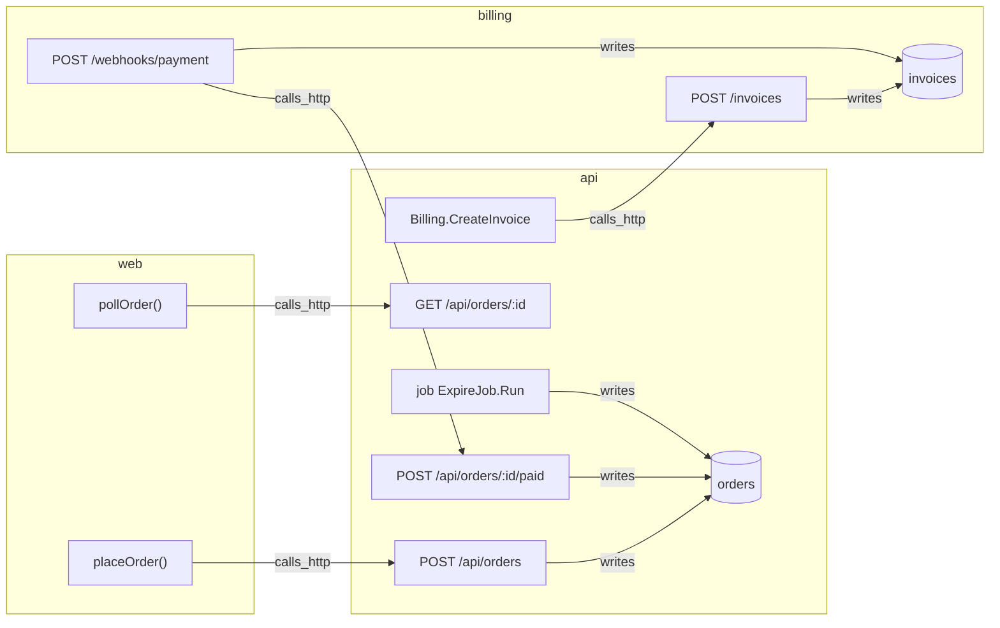

# BizMap

**Who reads and writes this column — across all your services — and what triggers it?**

BizMap is a static, deterministic data-lineage map for application code. Point it
at one or more repos and it answers, for every table and column:

- **who writes it** and **who reads it** (function, file, line)
- **what triggers that code**: HTTP route, scheduled job, queue consumer, DB trigger, Firestore event
- **which other service calls in**: front-end → API → internal service, matched across repos
- **why**, in the words already sitting in the code (the comment or docstring above the function)

No LLM, no tokens, no account, no server. It runs locally, and the same input always produces the same graph.

Typical questions it answers:

- *Can I drop or rename `orders.status`?* — every reader and writer, in every repo.
- *Which endpoints touch `users.email`?* — useful for LGPD/GDPR data mapping.
- *What happens to the database when the front-end calls `placeOrder()`?*

## A 30-second demo

[`examples/checkout`](examples/checkout) is three services sharing one Postgres:
**web** (TypeScript + axios) → **api** (Go + Echo + pgx) → **billing** (Python + FastAPI),
and billing calls the api back when a payment is confirmed.

```bash
pip install -e .
bizmap scan examples/checkout --mermaid
bizmap why orders.status
```

The diagram that `--mermaid` writes (entrypoint → table rollup plus cross-service
calls; `reads` edges omitted here for readability):



And `bizmap why orders.status` (trimmed):

```
column: orders.status (TEXT)

writers:
  [exact] api/main.Repo.ExpirePending  (repo.go:54) — ExpirePending releases orders that were never paid.
      triggered by api/scheduled job main.ExpireJob.Run — Run expires unpaid orders every minute so abandoned carts free their slot.
  [exact] api/main.Repo.InsertOrder  (repo.go:35) — InsertOrder stores a new pending order.
      triggered by api/HTTP POST /api/orders — CreateOrder records a checkout as pending and asks billing for an invoice.
      invoked via HTTP from web/src.checkout.placeOrder
  [exact] api/main.Repo.MarkPaid  (repo.go:48) — MarkPaid settles an order after billing confirms payment.
      triggered by api/HTTP POST /api/orders/:id/paid — MarkPaid is called by billing once the payment provider confirms the charge.
      invoked via HTTP from billing/app.payment_webhook

readers:
  [exact] api/main.Repo.GetOrder  (repo.go:42) — GetOrder loads one order by id.
      triggered by api/HTTP GET /api/orders/:id — GetOrder returns the order status for the confirmation page.
      invoked via HTTP from web/src.checkout.pollOrder
```

Three languages, four cross-service hops, every line backed by `file:line`.

## Quickstart

Python 3.11+:

```bash
pip install -e .                     # or: uv sync
bizmap scan path/to/repo --mermaid   # writes bizmap.graph.json (+ .mmd)
bizmap why orders.status             # writers, readers, triggers, callers
bizmap report path/to/repo           # how much of the code BizMap understood
```

Several services at once (one joint graph, cross-repo HTTP links matched):

```bash
bizmap scan ./web ./api ./billing --out merged.json
bizmap registry merge web.json api.json billing.json --out merged.json   # same result
```

A `bizmap.yaml` per repo (or one at the parent) is optional and only fills gaps:

```yaml
name: api
database: checkout            # repos with the same database share table ids
services:                     # which env var / host points at which service
  billing: { url: http://billing.internal, env: BILLING_URL }
exclude: [cmd/seed, demo/]
overrides:                    # anything static analysis cannot see
  columns:
    orders.status:
      why: "Lifecycle: pending → paid | expired"
```

## Coverage report

`bizmap report` tells you how much of a codebase BizMap understood: entrypoints that
reach a table, HTTP links matched vs. unresolved (by reason, with a hint for each),
how links were derived, and confidence.

```
entrypoints: 6  reaching a table/collection: 6 (100.0%)
http links: 4  (cross-repo 4)
unresolved http: 0
edges by confidence: exact 31, inferred 23
```

`--redact` replaces every name, route, table, URL, env key, and file with a salted
hash, so a report from a private codebase can be shared without sharing code:

```bash
bizmap report ./svc-a ./svc-b --redact --salt-file ~/.bizmap-salt --json
```

Only counts, edge types, entrypoint kinds and reasons stay readable. Without a
salt each run uses a random one (hashes differ between runs); `--salt-file`
creates a private salt once and reuses it so runs can be compared.

## PR impact comment

`bizmap impact` maps a diff onto the graph: each changed function → the entrypoints
that reach it (across services in a joint scan) and the tables/columns it, or
anything it calls, reads or writes. It prints Markdown with a Mermaid diagram.

```bash
bizmap scan examples/checkout --out /tmp/g.json
git diff --unified=0 origin/main... | bizmap impact --graph /tmp/g.json --prefix examples/checkout
```

As a GitHub Action (one comment per PR, updated on each push):

```yaml
on: pull_request            # not pull_request_target: never run PR code with a write token
permissions:
  contents: read
  pull-requests: write
concurrency:                # two quick pushes must not race to create two comments
  group: bizmap-impact-${{ github.event.pull_request.number }}
  cancel-in-progress: true
jobs:
  bizmap:
    runs-on: ubuntu-latest
    steps:
      - uses: actions/checkout@v4   # the base commit is fetched if missing; fetch-depth: 0 also works
      - uses: lucas-simao/bizmap@v0.3.10
        with:
          path: .            # or the workspace dir holding bizmap.yaml with `repos:`
```

The comment lists at most `max-rows` functions (default 50, ranked by how many
routes and tables they reach) and stays under GitHub's size limit; the workflow
run summary has the full list. PRs from forks get a read-only token, so they
only get the summary. If the scan fails, the comment says so and links the log.
Only comments by `comment-author` (default `github-actions[bot]`) are updated;
if the comments can't be listed, nothing is posted (no duplicates). The check is
advisory: a BizMap failure is reported in the comment and as a warning, and
fails the job only with `fail-on-error: "true"`. With `ref: <head sha>`
checkouts the diff starts at the merge base, so base-branch drift is not
reported.

Lines outside any function (imports, migrations, docs) are listed as unmapped and
don't produce impact.

## MCP server (for coding agents)

*Requires bizmap 0.4.0+ (until it is on PyPI: `pip install "git+https://github.com/lucas-simao/bizmap"`).*

`bizmap mcp` lets Claude Code, Cursor, Claude Desktop or any MCP client ask the
graph *what writes `orders.status`?*, *which routes reach `markPaid`?* or *what does
this diff touch?* instead of grepping. It is **read-only and offline** (reads the JSON
from `bizmap scan`, reloads it when you rescan), deterministic, and needs no extra
dependency.

```bash
bizmap scan . --out bizmap.graph.json
claude mcp add bizmap -- bizmap mcp --graph "$PWD/bizmap.graph.json"   # Claude Code
```

Cursor (`.cursor/mcp.json`):

```json
{ "mcpServers": { "bizmap": { "command": "bizmap", "args": ["mcp", "--graph", "${workspaceFolder}/bizmap.graph.json"] } } }
```

Claude Desktop (`claude_desktop_config.json`, absolute paths):

```json
{ "mcpServers": { "bizmap": { "command": "/home/you/.local/bin/bizmap", "args": ["mcp", "--graph", "/home/you/code/shop/bizmap.graph.json"] } } }
```

| Tool | Answers |
|---|---|
| `search` | functions, routes, tables, columns by name / path / doc comment → ids |
| `call_graph` | callers (and the routes/jobs that reach a function) and callees, across services |
| `function_data` | tables/columns a function or route reads and writes (`transitive` through callees) |
| `table_usage` | functions and routes that read/write a table or one column |
| `impact` | a unified diff → changed functions, routes and data (same as `bizmap impact`) |
| `why_column` | the `bizmap why` report for `table.column` |

Every item carries `evidence` (`file:line`) and, when it comes from an edge, a
`confidence`; lists are capped (`limit`, default 20) with totals. Setup per client,
the full input/output contract and troubleshooting: [docs/mcp.md](docs/mcp.md).

## What it understands

| | Routes / triggers | Data access | Outbound HTTP |
| --- | --- | --- | --- |
| **Go** | Echo (groups, const paths, wrappers), ticker/cron jobs | pgx, `database/sql`, sqlx | `net/http` (env/const/`Sprintf` URLs) |
| **Python** | FastAPI, Flask (routers, blueprints, factories), Celery, RQ, Cloud Tasks, Pub/Sub, Firebase Functions, `while True` workers | SQLAlchemy Core/ORM, raw SQL, SQL dicts/constants, Firestore, Supabase | httpx, requests, aiohttp |
| **JS / TS** | Express, Fastify, Hono (chains, mounts), Supabase Edge Functions | `pg`/`postgres`, Supabase | fetch, axios, ky, ofetch, got (instances, factories, `tsconfig` paths) |
| **SQL** | `CREATE TRIGGER` | schema replayed from `schema.sql` / migrations / Alembic, views, RLS policies | — |

When a client or executor cannot be traced through every layer, BizMap falls back to
evidence it can still see — an API path literal in a front-end function
(`via: route_literal`), or the SQL constant a handler names (`via: sql_reference`) —
and marks those links `inferred`. Details: [docs/how-it-works.md](docs/how-it-works.md).

## How it decides

- **Evidence over vibes.** Every edge stores `{file, line, symbol}`.
- **Confidence on every edge.** `exact` (static SQL / resolved handler), `inferred`
  (call-graph propagation, `SELECT *`, interface dispatch, fallbacks above), `unknown`
  (dynamic SQL like `"UPDATE " + table`).
- **Say when you do not know.** Dynamic SQL is `table:unknown`, ambiguous handlers list
  `candidates`, unmatched HTTP calls are kept as `unresolved_http` with a `reason`
  (`target_not_scanned`, `base_unknown`, `path_dynamic`, `client_unknown`).
- **Deterministic.** Byte-identical output for identical input, checked in CI across
  hash seeds; every bundled example has a golden snapshot.
- **Static means static.** SQL rewritten at runtime (`sql.replace(...)`,
  `.format()` with runtime values) is read as written in the source.
- **JS/TS import resolution** follows relative paths, `index` barrels,
  `export … from`, tsconfig `paths` and Vite `resolve.alias`; Webpack aliases are
  not read. Same-named local helpers in two sibling anonymous callbacks share one
  id (only one is kept).
- **No AI in the core, ever.** Models are welcome as *clients* of the graph (MCP is on
  the roadmap), not as its authors.

## How it compares

- **Code search / call graphs** (Sourcegraph, CodeQL, tree-sitter code-graph MCP servers)
  know functions and calls, but not which **table and column** a function touches, nor
  which route in *another* repo an HTTP client hits.
- **Data-pipeline lineage** (dbt, OpenLineage, warehouse catalogs) starts at the
  warehouse or at runtime; it does not see the application code that writes the data.
- **Commercial code-level lineage** (Gable, Foundational) does this for data teams as a
  hosted platform. BizMap is the open-source, local, developer-first take on it.

## Roadmap

- **Shipped in v0.3.3** — `bizmap impact` + GitHub Action that comments on each PR
  with the routes, functions, tables and columns it impacts (and a Mermaid diagram).
- **v0.4** — MCP server so coding agents can ask `why orders.status` instead of grepping
  (`bizmap mcp`, in progress on `main`).
- Static graph page (GitHub Pages).

Full history: [CHANGELOG.md](CHANGELOG.md). Graph format:
[docs/graph-schema.md](docs/graph-schema.md). Detector rules:
[docs/detector-rules.md](docs/detector-rules.md).

## Releasing

Bump the version (`pyproject.toml`, `src/bizmap/__init__.py`, graph version,
`docs/graph-schema.md`, README `@vX.Y.Z`), date the CHANGELOG section, merge, then
push a tag on that commit:

```bash
git tag -a vX.Y.Z <commit> -m "vX.Y.Z" && git push origin vX.Y.Z
```

`.github/workflows/release.yml` checks that the tag is on `main` and matches the
version and the CHANGELOG, runs the tests, builds, publishes to PyPI with Trusted
Publishing (no token) and creates the GitHub release with that CHANGELOG section.
One-time setup is described at the top of the workflow. Tags on commits older
than the workflow (v0.3.3–v0.3.5) are published with **Actions → Release → Run
workflow** (from `main`) and the tag name. Limit the `pypi` environment to
`main` and `v*` tags (Deployment branches and tags) so no other branch can
publish.

## Development

```bash
pip install -e ".[dev]"
ruff check src tests
pytest -q
```

`tests/test_snapshots.py` keeps a golden, line-per-link summary of every example in
`tests/snapshots/*.txt` and checks that each example scans to byte-identical JSON under
several `PYTHONHASHSEED` values. When a detector change is intended, refresh with
`BIZMAP_UPDATE_SNAPSHOTS=1 pytest tests/test_snapshots.py` and review the `+`/`-` diff
in the PR.

Fixtures are synthetic (`orders`, `users`, `invoices`, …); no proprietary code is
included. MIT licensed. Contributions that add detector rules for new frameworks are
especially welcome — please include a minimal example and let the snapshot diff show
what changed.
