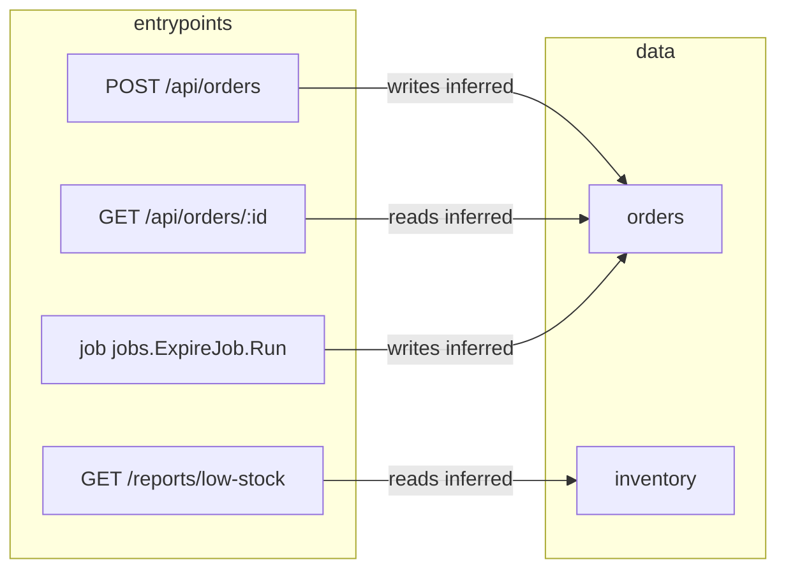

# BizMap

**Deterministic** business-rule and data-lineage map for a codebase.

For each database table and column, BizMap answers:

- **who writes it** (function / repository method)
- **triggered by what** (HTTP route, scheduled job, DB trigger — queues/webhooks later)
- **in which situation** (the comment or docstring already sitting above that function, plus const/iota arguments when seen)
- **who reads it**

Output is a graph (`bizmap.graph.json`) that AI tools can query later (MCP in a
future version) and that will power PR conflict warnings (also later).

BizMap **does not call an LLM**. No tokens, no accounts, no “guess the business
rule”. SQL is parsed with [sqlglot](https://github.com/tobymao/sqlglot)
(PostgreSQL dialect). Code is parsed with [tree-sitter](https://tree-sitter.github.io/).
Frameworks are declared in YAML so the community can add Echo, FastAPI, Express,
… without changing the engine. Findings carry a confidence of `exact`,
`inferred`, or `unknown` (for example dynamically built SQL like
`"UPDATE t SET " + col`). Anything the scanner cannot see can be completed in a
`bizmap.yaml` overrides file.

## Quickstart

Python 3.11+:

```bash
pip install -e ".[dev]"
bizmap scan examples/shop --mermaid
bizmap why orders.status
```

With [uv](https://astral.sh/uv):

```bash
uv sync --extra dev
uv run bizmap scan examples/shop --mermaid
uv run bizmap why orders.status
```

`scan` writes `bizmap.graph.json` (and `bizmap.graph.mmd` with `--mermaid`).
`why TABLE.COLUMN` prints writers, readers, and the entrypoints that trigger them.

`--mermaid` is an **entrypoint → table** rollup (readable on large apps).
Use `--mermaid-focus orders` for the neighborhood of one table, and
`--expand-star` only if you want `SELECT *` expanded to schema columns at the
SQL origin.

`bizmap.yaml` is loaded from `--config path`, else the scan root, else the
git toplevel. `exclude` globs skip seed/demo trees inside the scan root.

### Example `why` output

```
column: orders.status (TEXT)

writers:
  [exact] repository.Repo.InsertOrder  (repository/repository.go:112 repository.Repo.InsertOrder)
      triggered by HTTP POST /api/orders — CreateOrder records a paid checkout and reserves inventory.
  [exact] repository.Repo.ExpirePendingOrders  (repository/repository.go:148 repository.Repo.ExpirePendingOrders)
      triggered by scheduled job jobs.ExpireJob.Run — Run expires unpaid checkout sessions so reserved inventory can be released.
  [inferred] handlers.Handler.CreateOrder  (handlers/handlers.go:41 handlers.Handler.CreateOrder)
      triggered by HTTP POST /api/orders — CreateOrder records a paid checkout and reserves inventory.

readers:
  [exact] repository.Repo.GetOrder  (repository/repository.go:129 repository.Repo.GetOrder)
      triggered by HTTP GET /api/orders/:id — GetOrder returns an order and its line items for the confirmation screen.
```

### Example mermaid (entrypoint → table rollup)

`bizmap scan examples/shop --mermaid` produces a flowchart of HTTP/job
entrypoints and the tables they touch:



## How it works (v0.1.2)

1. **Schema replayer** — applies `schema.sql` / migration folders in order
   (`CREATE TABLE IF NOT EXISTS`, `ALTER TABLE ... ADD COLUMN IF NOT EXISTS`,
   drop/add constraints, `DO $$` blocks) and extracts `CREATE TRIGGER` plus the
   tables/columns their plpgsql functions write.
2. **Go detector** — Echo v4 routes (`group.POST(path, handler)` with group
   prefixes, cross-package consts, factory handlers, and wrappers such as
   `wrap(h.Version)`). Method names must be exactly `GET`/`POST`/…/`Any`/`Match`
   with a string-like path. pgx v5 `tx.Exec|Query|QueryRow(ctx, sql, args)`,
   and **any** `go` statement whose target uses `time.NewTicker` / `time.Tick`
   / `time.After` loops or a cron library. Packages are keyed by import path;
   display names are always the directory relative to the scan root.
3. **Call graph** — handler → service → repository using typed locals,
   constructors, import aliases, and injected func fields
   (`Service{ring: notify.Send}`). Unscanned/unknown receivers stay unresolved
   (no unique-name fallback). Inferred calls require a unique callee inside
   the resolved package/type set. Reads/writes propagate to HTTP and job
   entrypoints as table-level `inferred` edges; `table:unknown` does not.
4. **SQL** — named columns stay column-level; `SELECT *` and column-less
   INSERT are table-level. FROM-less SELECT (`now()`, `set_config`) touches
   no table. CTE/subquery/LATERAL aliases and catalogs like `pg_roles` are
   not app tables.
5. **Python detector** — enough FastAPI + SQL-literal capture to map a worker
   that reads the same tables. SQLAlchemy `text()`/`execute()` is wired;
   Express is a YAML stub for v0.2.
6. **Overrides** — `bizmap.yaml` (`--config`, scan root, or git toplevel)
   fills in `why`, extra edges, `exclude` globs, and `expand_star`.

### Performance

v0.1.2 caches per-function local type maps so call resolution stays close to
v0.1 speed. On the synthetic fixtures, `bizmap scan examples/shop` and
`examples/clinic` finish in tens of milliseconds on a laptop; the cache is
aimed at large trees where v0.1.1 walked types on every call.

Graph format: [docs/graph-schema.md](docs/graph-schema.md).  
YAML rule format: [docs/detector-rules.md](docs/detector-rules.md).  
Changes: [CHANGELOG.md](CHANGELOG.md).

Synthetic stand-ins (no proprietary code): `examples/shop` (happy path) and
`examples/clinic` (colliding handler names, same-named packages, jobs, const
paths, factory handlers).

## Philosophy

- **No AI in v0.1 (or in the core, ever).** Models are welcome as *clients* of
  the graph (MCP), not as authors of it.
- **Evidence over vibes.** Every edge stores `{file, line, symbol}`.
- **Say when you do not know.** Dynamic SQL is `unknown`, not a hallucinated
  column list. Ambiguous handlers list `candidates` instead of guessing.
- **Business “why” is already in the repo** — comments and docstrings — or it
  is written down in `bizmap.yaml` by a human.

## Roadmap

- **v0.2** — first-class Python and TypeScript detectors (SQLAlchemy ORM,
  Express/Fastify) plus a cross-repo registry so a table can be written in
  service A and read in service B.
- **v0.3** — GitHub Action that warns when a PR changes a writer of a column
  that another in-flight PR also touches (“lineage conflict”).
- **v0.4** — MCP server so agents can query `why orders.status` without
  scraping JSON.

## Development

```bash
pip install -e ".[dev]"
ruff check src tests
pytest -q
```

MIT licensed. Contributions that add YAML detector rules for new frameworks
are especially welcome.
