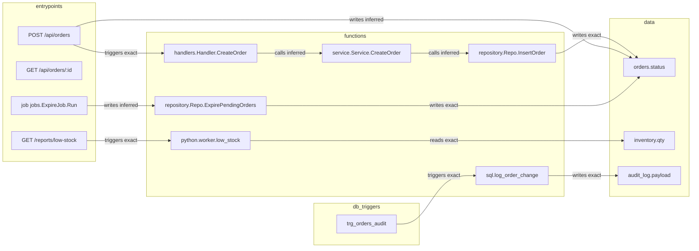

# BizMap

**Deterministic** business-rule and data-lineage map for a codebase.

For each database table and column, BizMap answers:

- **who writes it** (function / repository method)
- **triggered by what** (HTTP route, scheduled job, DB trigger — queues/webhooks later)
- **in which situation** (the comment or docstring already sitting above that function)
- **who reads it**

Output is a graph (`bizmap.graph.json`) that AI tools can query later (MCP in a
future version) and that will power PR conflict warnings (also later).

BizMap **does not call an LLM**. No tokens, no accounts, no “guess the business
rule”. SQL is parsed with [sqlglot](https://github.com/tobymao/sqlglot)
(PostgreSQL dialect). Code is parsed with [tree-sitter](https://tree-sitter.github.io/).
Frameworks are declared in YAML so the community can add Echo, FastAPI, Express,
… without changing the engine. Findings carry a confidence of `exact`,
`inferred`, or `unknown` (for example dynamically built SQL like
`"UPDATE t SET " + col`). Anything the scanner cannot see can be completed in a
`bizmap.yaml` overrides file.

## Quickstart

Python 3.11+:

```bash
pip install -e ".[dev]"
bizmap scan examples/shop --mermaid
bizmap why orders.status
```

With [uv](https://github.com/astral-sh/uv):

```bash
uv sync --extra dev
uv run bizmap scan examples/shop --mermaid
uv run bizmap why orders.status
```

`scan` writes `bizmap.graph.json` (and `bizmap.graph.mmd` with `--mermaid`).
`why TABLE.COLUMN` prints writers, readers, and the entrypoints that trigger them.

### Example `why` output

```
column: orders.status (TEXT)

writers:
  [exact] repository.Repo.InsertOrder  (repository/repository.go:112 repository.Repo.InsertOrder)
      triggered by HTTP POST /api/orders — CreateOrder records a paid checkout and reserves inventory.
  [exact] repository.Repo.ExpirePendingOrders  (repository/repository.go:148 repository.Repo.ExpirePendingOrders)
      triggered by scheduled job jobs.ExpireJob.Run — Run expires unpaid checkout sessions so reserved inventory can be released.
  [inferred] handlers.Handler.CreateOrder  (handlers/handlers.go:41 handlers.Handler.CreateOrder)
      triggered by HTTP POST /api/orders — CreateOrder records a paid checkout and reserves inventory.

readers:
  [exact] repository.Repo.GetOrder  (repository/repository.go:129 repository.Repo.GetOrder)
      triggered by HTTP GET /api/orders/:id — GetOrder returns an order and its line items for the confirmation screen.
```

### Example mermaid (generated from the graph)

`bizmap scan examples/shop --mermaid` produces a flowchart. A slice of the shop
example:



## How it works (v0.1)

1. **Schema replayer** — applies `schema.sql` / migration folders in order
   (`CREATE TABLE IF NOT EXISTS`, `ALTER TABLE ... ADD COLUMN IF NOT EXISTS`,
   drop/add constraints, `DO $$` blocks) and extracts `CREATE TRIGGER` plus the
   tables/columns their plpgsql functions write.
2. **Go detector** — Echo v4 routes (`group.POST("/path", handler)`), pgx v5
   `tx.Exec|Query|QueryRow(ctx, sql, args)`, and `go x.Run(ctx)` jobs that use
   `time.NewTicker`. SQL literals and same-package const concatenation are
   parsed; dynamic pieces are `unknown`.
3. **Call graph** — simple intra-project walk (handler → service → repository)
   so reads/writes propagate to HTTP and job entrypoints as `inferred`.
4. **Python detector** — enough FastAPI + SQL-literal capture to map a worker
   that reads the same tables. SQLAlchemy `text()`/`execute()` is wired;
   Express is a YAML stub for v0.2.
5. **Overrides** — `bizmap.yaml` next to the tree fills in `why` and extra
   edges the scanner cannot prove.

Graph format: [docs/graph-schema.md](docs/graph-schema.md).  
YAML rule format: [docs/detector-rules.md](docs/detector-rules.md).

First real target: a Go monorepo (Echo + pgx + ticker jobs + a single
idempotent `schema.sql`). The `examples/shop` tree is a synthetic stand-in —
no proprietary code.

## Philosophy

- **No AI in v0.1 (or in the core, ever).** Models are welcome as *clients* of
  the graph (MCP), not as authors of it.
- **Evidence over vibes.** Every edge stores `{file, line, symbol}`.
- **Say when you do not know.** Dynamic SQL is `unknown`, not a hallucinated
  column list.
- **Business “why” is already in the repo** — comments and docstrings — or it
  is written down in `bizmap.yaml` by a human.

## Roadmap

- **v0.2** — first-class Python and TypeScript detectors (SQLAlchemy ORM,
  Express/Fastify) plus a cross-repo registry so a table can be written in
  service A and read in service B.
- **v0.3** — GitHub Action that warns when a PR changes a writer of a column
  that another in-flight PR also touches (“lineage conflict”).
- **v0.4** — MCP server so agents can query `why orders.status` without
  scraping JSON.

## Development

```bash
pip install -e ".[dev]"
ruff check src tests
pytest -q
```

MIT licensed. Contributions that add YAML detector rules for new frameworks
are especially welcome.
