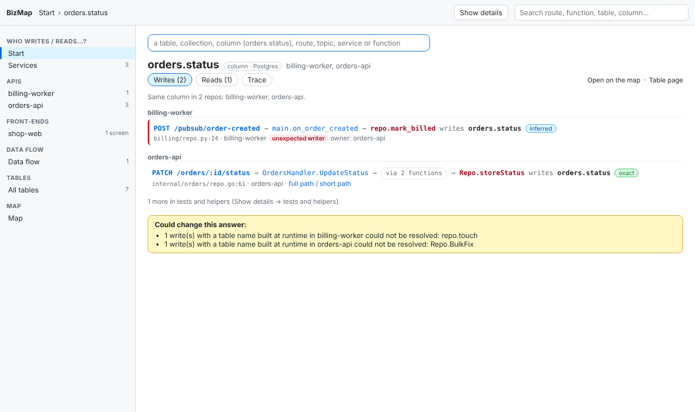
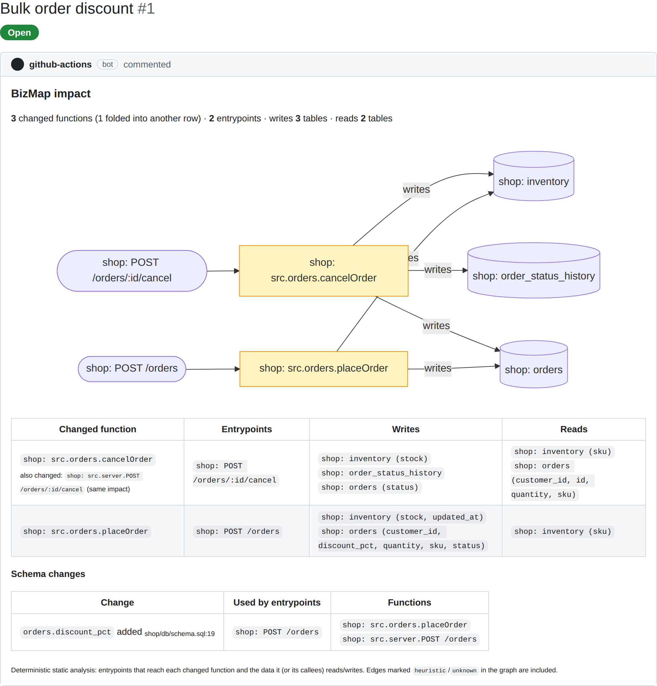

# BizMap

[](https://pypi.org/project/bizmap/)
[](https://pypi.org/project/bizmap/)
[](https://github.com/lucas-simao/bizmap/actions/workflows/ci.yml)
[](https://lucas-simao.github.io/bizmap/)
[](LICENSE)

📖 **Documentation: [lucas-simao.github.io/bizmap](https://lucas-simao.github.io/bizmap/)**

**Who reads and writes this column — across all your services — and what triggers it?**

BizMap reads your code and maps every entrypoint (HTTP route, job, queue
consumer, database trigger) through the functions it calls to the tables and
columns they read and write, across repositories and languages. It is static
and deterministic: no LLM, no tokens, no account, no server.



<sub>`bizmap export --format html` on a fictional three-repo shop: the page opens on *who writes / reads X?* and answers like `bizmap who-writes`.</sub>

**[Documentation](https://lucas-simao.github.io/bizmap/)** ·
**[Live demo](https://lucas-simao.github.io/bizmap-demo-api/)** ([Go API](https://github.com/lucas-simao/bizmap-demo-api) + [TypeScript storefront](https://github.com/lucas-simao/bizmap-demo-web)) ·
[Changelog](CHANGELOG.md) · [PyPI](https://pypi.org/project/bizmap/)

## Install

```bash
pipx install bizmap        # or: pip install bizmap   (Python 3.11+)
```

## Quickstart

```bash
bizmap scan . --mermaid          # writes bizmap.graph.json (+ bizmap.graph.mmd)
bizmap who-writes orders.status  # every writer, from the route / consumer / job that runs it
bizmap who-reads orders          # every reader
bizmap trace collection:orders   # where its data comes from and goes (feeds, queues, HTTP)
bizmap export --format html --out bizmap.html   # one offline page that opens on "who writes / reads X?"
bizmap why orders.status         # writers, readers, what triggers them, who calls in
bizmap report                    # how much of the code BizMap understood
```


<sub>`bizmap scan` and `bizmap why`, recorded on an earlier version of the demo (a TypeScript shop and a Python payments service).</sub>

Several services at once — one graph, HTTP calls between them matched:

```bash
bizmap scan --discover .                    # every git repo under the current folder
bizmap report --cross-service               # which routes reach which services over HTTP
bizmap scan ./web ./api ./billing           # or list them (or a bizmap.yaml with `repos:`)
```

Try it on the demo in one minute: **Northwind Outfitters**, a fictional shop split
in two repos — a [Go API](https://github.com/lucas-simao/bizmap-demo-api) (Echo, Postgres, Firestore) and a
[TypeScript storefront](https://github.com/lucas-simao/bizmap-demo-web) that calls it and shares a Firestore collection
with it. Or open its [live map](https://lucas-simao.github.io/bizmap-demo-api/) without installing anything.

```bash
git clone https://github.com/lucas-simao/bizmap-demo-api && cd bizmap-demo-api
git clone https://github.com/lucas-simao/bizmap-demo-web .bizmap/web
bizmap scan .bizmap --out bizmap.graph.json   # both repos, one graph
bizmap who-writes orders.status               # the 4 routes and the expiry job
bizmap trace order_events                     # Postgres → Firestore → a Cloud Function in the other repo
```

## What it answers

- *Can I drop or rename `orders.status`?* — every reader and writer, in every repo.
- *Which endpoints touch `users.email`?* — useful for LGPD/GDPR data mapping.
- *What happens to the database when the front-end calls `placeOrder()`?*
- *What does this pull request touch?* — as a comment, on every push.

Every answer points at `file:line` and carries a confidence (`exact`,
`inferred`, `unknown`). What BizMap cannot see — dynamic SQL, a URL built at
runtime, a service that was not scanned — is reported as such, not guessed.

## Ask from the terminal

```text
$ bizmap who-writes table:orders
Who writes orders (table · Postgres · billing-worker, orders-api)

billing-worker
  pubsub order-created → consumer.handle_order_created → repo.mark_billed  writes orders (status)  [exact]
      billing/repo.py:24

orders-api
  PATCH /orders/{id}/status → OrdersHandler.UpdateStatus → Repo.SetStatus  writes orders (status)  [exact]
      internal/orders/repo.go:33

Could change this answer:
  1 write(s) with a table name built at runtime in orders-api could not be resolved: Repo.BulkFix
```

`bizmap who-reads` does the same for readers and `bizmap trace` follows the
data across tables, queues and services. A name that matches different things
(a Firestore collection and a Postgres table called `orders`) is listed, never
guessed. `--format json` (stable, `bizmap.query/v1`) for tools, `--format md`
for a PR, `--lang pt-BR`. See [the docs](https://lucas-simao.github.io/bizmap/commands/query/).

## What it finds

| | Routes / triggers | Data access | Outbound HTTP |
| --- | --- | --- | --- |
| **Go** | Echo (groups, const paths, wrappers), ticker/cron jobs | pgx, `database/sql`, sqlx | `net/http` (env/const/`Sprintf` URLs) |
| **Python** | FastAPI, Flask (routers, blueprints, factories), Celery, RQ, Cloud Tasks, Pub/Sub, Firebase Functions, `while True` workers | SQLAlchemy Core/ORM, raw SQL, SQL dicts/constants, Firestore, Supabase | httpx, requests, aiohttp |
| **JS / TS** | Express, Fastify, Hono (chains, mounts), Supabase Edge Functions | `pg`/`postgres`, Supabase | fetch, axios, ky, ofetch, got (instances, factories, `tsconfig` paths) |
| **SQL** | `CREATE TRIGGER` | schema replayed from `schema.sql` / migrations / Alembic, views, RLS policies | — |

| Database | |
| --- | --- |
| **PostgreSQL** | schema, migrations, views, triggers and the tables their functions write, RLS policies |
| **Supabase** | Postgres + `from()` / `rpc()` + Edge Functions |
| **Firestore** | collections, document refs, transactions and batches, Firebase triggers |

Details per detector: [Languages and detectors](https://lucas-simao.github.io/bizmap/languages/).

## Pull request comment

The GitHub Action posts one comment per PR (updated on each push) with the
routes, functions, tables and columns the change reaches — across services —
and flags migrations that drop or rename columns still in use.

```yaml
# .github/workflows/bizmap-impact.yml
on: pull_request
permissions:
  contents: read
  pull-requests: write
jobs:
  bizmap:
    runs-on: ubuntu-latest
    steps:
      - uses: actions/checkout@v4   # the base commit is fetched if missing; fetch-depth: 0 also works
      - uses: lucas-simao/bizmap@v0.17.2
        with:
          path: .
```



Live examples: the pull requests of [bizmap-demo-api](https://github.com/lucas-simao/bizmap-demo-api/pulls) and
[bizmap-demo-web](https://github.com/lucas-simao/bizmap-demo-web/pulls).
Inputs, outputs and behaviour: [GitHub Action](https://lucas-simao.github.io/bizmap/github-action/).

## Ask the graph from your coding agent (MCP)

`bizmap mcp` serves the graph to Claude Code, Cursor, Claude Desktop or any MCP
client — read-only and offline — so an agent can ask *what writes
`orders.status`?* or *what does this diff touch?* instead of grepping.

```bash
bizmap scan . --out bizmap.graph.json
claude mcp add bizmap -- bizmap mcp --graph "$PWD/bizmap.graph.json"   # Claude Code
```

Cursor (`.cursor/mcp.json`):

```json
{ "mcpServers": { "bizmap": { "command": "bizmap", "args": ["mcp", "--graph", "${workspaceFolder}/bizmap.graph.json"] } } }
```

Tools (`search`, `call_graph`, `function_data`, `table_usage`, `impact`,
`why_column`) and other clients: [MCP server](https://lucas-simao.github.io/bizmap/mcp/).

## Interactive map (HTML)

```bash
bizmap export --graph bizmap.graph.json --format html --out bizmap.html   # --lang pt-BR
```

One self-contained, offline HTML file. It opens on the question you came with —
**who writes / reads `orders.status`?** — answered like `bizmap who-writes` (entrypoint →
via N functions → the writer, confidence, `file:line`, and what could change the answer),
then a summary strip, findings (an unexpected writer, tables written by several services,
names built at runtime, orphan functions), a services × tables matrix and a map around
the entity you pick.


Below that, it reads the system like a book: services,
then domains (routes grouped by path), then a route's call tree down to the tables and
columns it reads and writes. Front-ends list their screens, the routes each one uses
and the calls that matched no route. Search finds any route, function, table or column.

Details: [export](https://lucas-simao.github.io/bizmap/commands/export/) ·
[the start screen](https://lucas-simao.github.io/bizmap/commands/export-home/).

## Documentation

| | |
| --- | --- |
| [Getting started](https://lucas-simao.github.io/bizmap/getting-started/) | Install and walk through the demo |
| [Configuration](https://lucas-simao.github.io/bizmap/configuration/) | `bizmap.yaml`: `services:`, `database:`, `repos:`, excludes, overrides |
| [Commands](https://lucas-simao.github.io/bizmap/commands/) | `scan`, `why`, `who-writes`, `who-reads`, `trace`, `report`, `impact`, `registry`, `mcp`, `export` |
| [MCP server](https://lucas-simao.github.io/bizmap/mcp/) | Let Claude Code, Cursor or any MCP client query the graph |
| [GitHub Action](https://lucas-simao.github.io/bizmap/github-action/) | The PR comment |
| [Graph format](https://lucas-simao.github.io/bizmap/graph-schema/) | `bizmap.graph.json`, node and edge types, confidence |
| [FAQ and limitations](https://lucas-simao.github.io/bizmap/faq/) | What static analysis can and cannot see |

## How it compares

- **Code search / call graphs** (Sourcegraph, CodeQL, tree-sitter code-graph MCP servers)
  know functions and calls, but not which **table and column** a function touches, nor
  which route in *another* repo an HTTP client hits.
- **Data-pipeline lineage** (dbt, OpenLineage, warehouse catalogs) starts at the
  warehouse or at runtime; it does not see the application code that writes the data.
- **Commercial code-level lineage** (Gable, Foundational) does this for data teams as a
  hosted platform. BizMap is the open-source, local, developer-first take on it.

## Contributing

Contributions are welcome, especially detector rules for new frameworks: see
[CONTRIBUTING.md](CONTRIBUTING.md) for the development setup, the snapshot tests
and how releases are cut. Fixtures are synthetic; no proprietary code is
included. MIT licensed.
