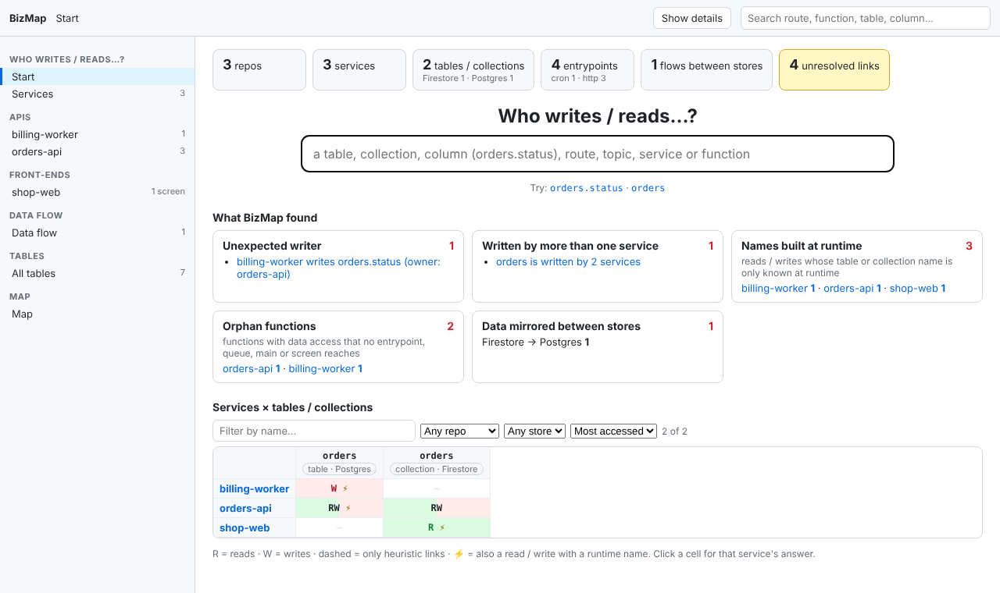
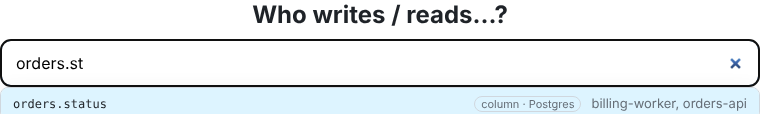
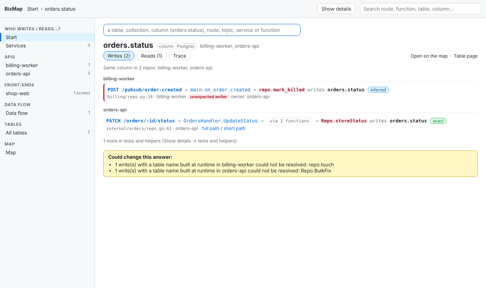
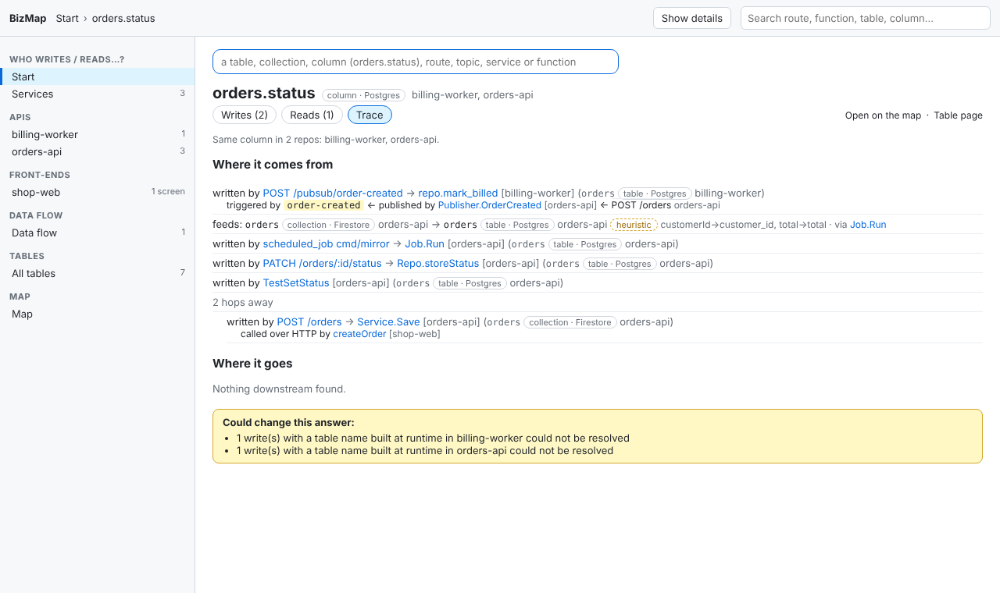
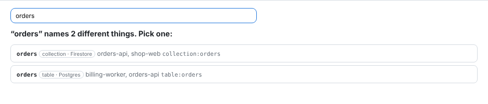
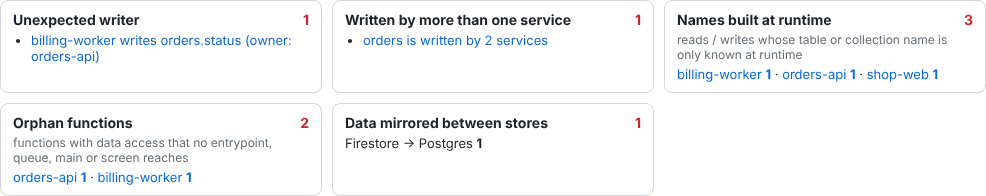
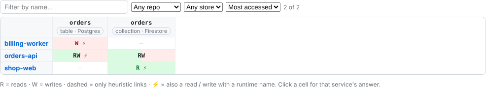
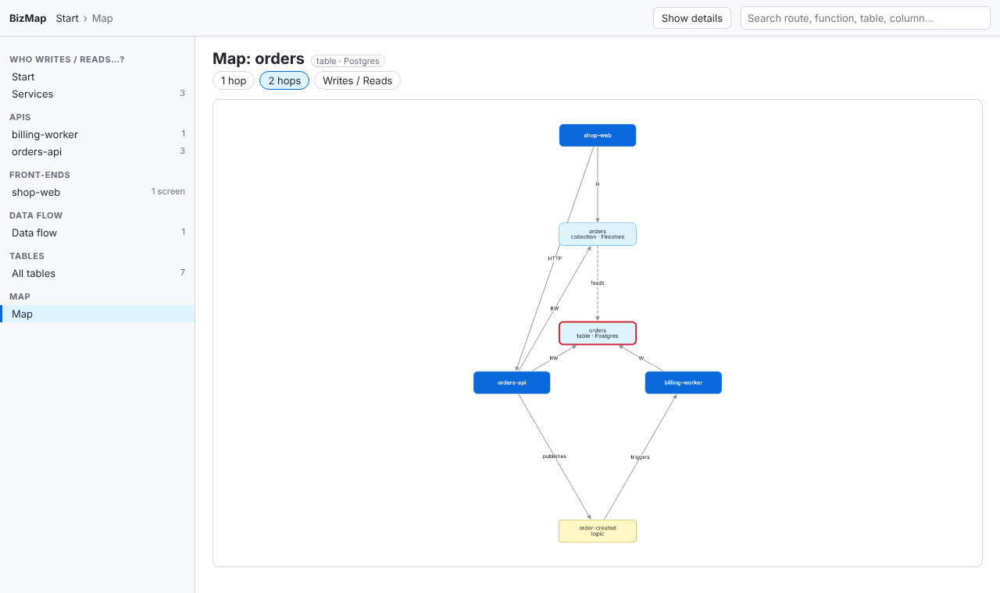

# `bizmap export`: the start screen

*Unreleased (after 0.13.0).*

The HTML page opens on **the question you came with** — *who writes / reads
this?* — instead of everything BizMap knows. Under it: a summary you can click
through, what BizMap found worth a look, and a services × tables matrix. The
graph moved to its own tab and always starts from one thing you pick.

```bash
bizmap scan --discover . --out bizmap.graph.json
bizmap export --graph bizmap.graph.json --format html --out bizmap.html   # --lang pt-BR
```

The screenshots below are the fictional three-repo repro used by the tests
(`tests/fixtures/home_repro.py`): `orders-api` (Go), `shop-web` (TS, Firebase)
and `billing-worker` (Python), which also writes `orders.status`.



## 1. Summary strip


Repos · services · tables / collections (by store) · entrypoints (routes,
queue consumers, triggers, cron, `main`) · flows between stores (`feeds`
edges whose ends are in different stores) · **unresolved links**. Each number
opens its list. The unresolved count is always shown, even when it is
**0 unresolved**: HTTP calls that matched no route, reads / writes whose table
or collection name is built at runtime, and publishes to a topic only known at
runtime. Any of them can change an answer.

## 2. Who writes / reads X?

The cursor starts in the big search box. It takes a table, a collection, a
column (`orders.status`), a route (`PATCH /orders/:id/status`), a topic, a
service or a function, and each suggestion says what it is:
`column · Postgres`, `collection · Firestore`, `route`, `topic`…



Enter on a table, collection or column opens its answer, with three tabs —
**Writes**, **Reads** and **Trace** (where the data comes from and where it
goes). A route, function or service opens its page; a topic opens who
publishes it, who consumes it and what they write.



Each line is the same as `bizmap who-writes`: *entrypoint → handler →
(via N functions) → the function that writes*, the column(s), the confidence
and `file:line`, grouped by repo. **via N functions** (and the *full path*
link) expands to every function on the way — the page's `--path`. A writer
from a service that is not the table's owner gets an **unexpected writer**
badge (see [Owner](#owner-and-unexpected-writers)). Every answer ends with
*Could change this answer*, the same lines the CLI prints.



**One engine.** The answers are computed in the page by the CLI's query
engine (`src/bizmap/query.py`) ported line by line to JavaScript
(`src/bizmap/export/query.js`), on the same graph. They are the same
`bizmap.query/v1` JSON `bizmap who-writes X --format json` prints; the tests
compare both for every table, collection and column of the repro (and a
random sample of a large synthetic graph), and against the CLI itself.
`window.__bizmap.answer("orders.status", "writes")` returns it in the
browser console.

**A name that means several things** (a Firestore collection and a Postgres
table called `orders`, the same table in two databases) is never picked
silently: Enter lists the candidates with kind · store · repos.



## 3. What BizMap found



Each card opens its list (or the answer); a kind with no finding says
**none**.

- **Unexpected writer** — a table written by a service that is not its owner.
- **Written by more than one service** — with the count per table.
- **Names built at runtime** — reads / writes whose table or collection name
  is only known at runtime (`doc(db, name, id)`, an f-string), per service.
- **Orphan functions** — functions with data access that nothing reaches
  through calls / triggers from an entrypoint, a queue, a `main` or a UI file.
- **Data mirrored between stores** (Firestore → Postgres…), and **written and
  never read / read and never written**, when there are any.

### Owner and unexpected writers

The owner of a table is, in this order:

1. the one service whose repo declares it in DDL / a migration (the table is
   not an `unresolved_relation`, and it has typed columns or a `.sql` /
   migration file as evidence);
2. else the service with strictly more functions writing it than any other;
3. else none (no card for that table).

Every other service that writes it is an unexpected writer. It is a hint to
look, not a verdict: a worker that owns a status update is fine once you know
it is there.

## 4. Services × tables / collections



Rows are services, columns are tables / collections (kind · store), a cell is
**R**, **W** or **RW** (in Portuguese **L**, **E**, **LE**). A dashed cell has
only heuristic links; ⚡ marks a service that also reads / writes a table or
collection whose name is built at runtime. Click a cell for the answer of that
service only; click a column header for the whole answer. Filter by text,
repo and store; sort by most accessed, most services or name. Only the top 30
columns are drawn, **Show more** adds 30 at a time; the header row and the
service column stay in place while you scroll.

## 5. Map



The **Map** tab never draws the whole system: it asks what to center on (a
table, collection, service or topic) and draws its neighbours **1 or 2 hops**
away — services that read / write it, the tables that feed it, the topics
between services (at most 150 nodes). From `orders · table`, 1 hop shows the
collection that feeds it and the two services that write it; 2 hops adds the
`order-created` topic and `shop-web`.

## 6. Show details

By default the page hides intermediate functions (they become *via N
functions*), columns as map nodes (they stay on the table page), and code in
tests, mocks, fixtures, generated code, `scripts/` and `tools/`. **Show
details** in the header turns each back on:

| Option | What changes |
| --- | --- |
| intermediate functions | answers show the full path; the map draws the functions between a service and the centered table |
| columns | the map draws the centered table's columns |
| tests and helpers | answers, cards, matrix and map include tests and helpers (an answer says how many it hides) |

The choice goes in the URL (`?d=ict`) and follows every link, so a shared link
opens the same view.

Confidence reads the same everywhere: **exact**, **inferred**, **heuristic**
(dashed) on answers, cards, matrix cells and map edges.

## Large graphs

On a 70k-node graph the page still opens at once: the index read on open holds
only the summary, the cards and one small record per table / collection.
The graph the engine needs (~7 MB on 70k nodes) is parsed on the first
question; columns, the map's graph and the findings' full lists are read on
first use. Long answers show 100 lines at a time, the matrix 30 columns at a
time, suggestions 12. It is still one offline file with no external
dependency. A test opens a 40k-node synthetic graph and checks that the start
screen draws a bounded number of elements, that search and the matrix page,
and that sampled answers still equal the CLI's.

The services overview the page used to open on is now **Services**
(`#/system`) in the left navigation.
