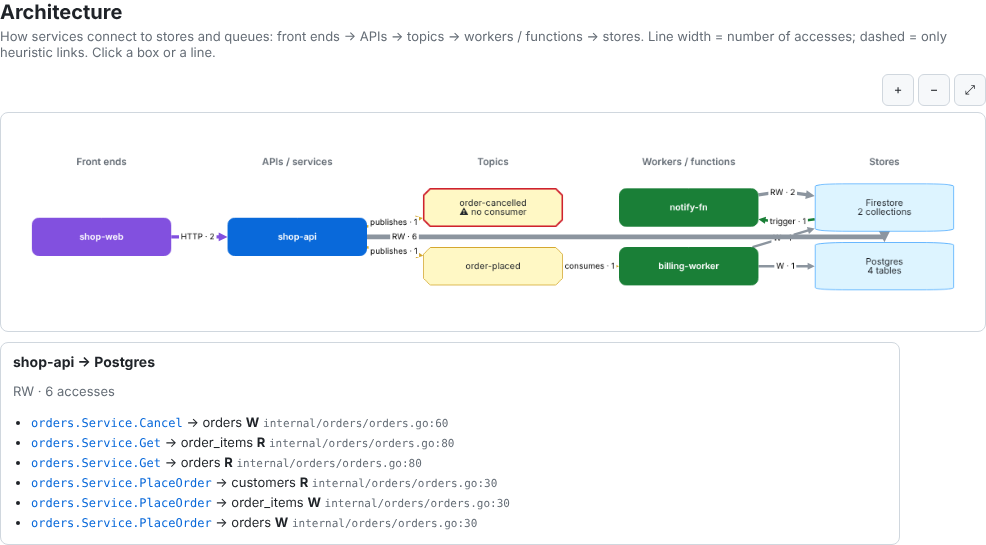
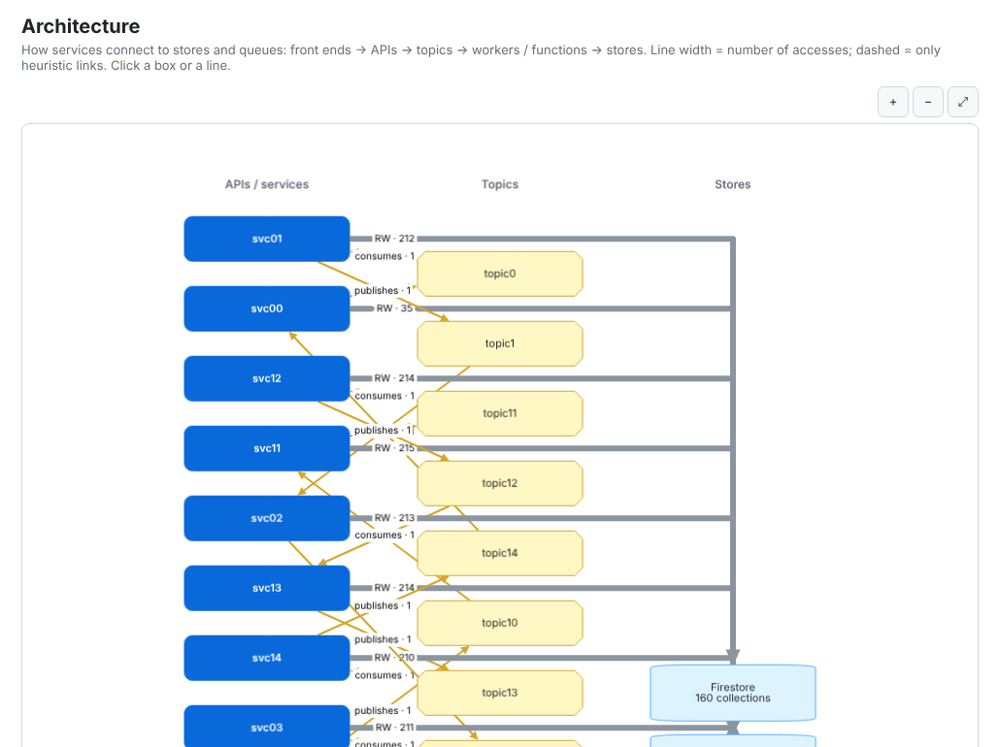
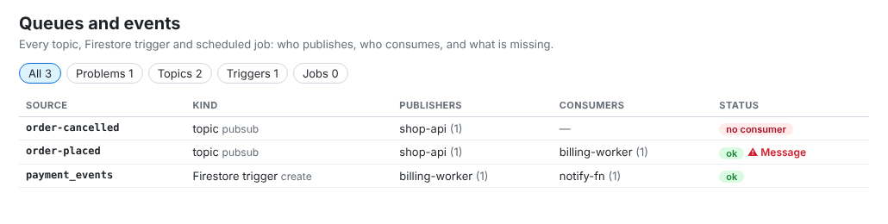
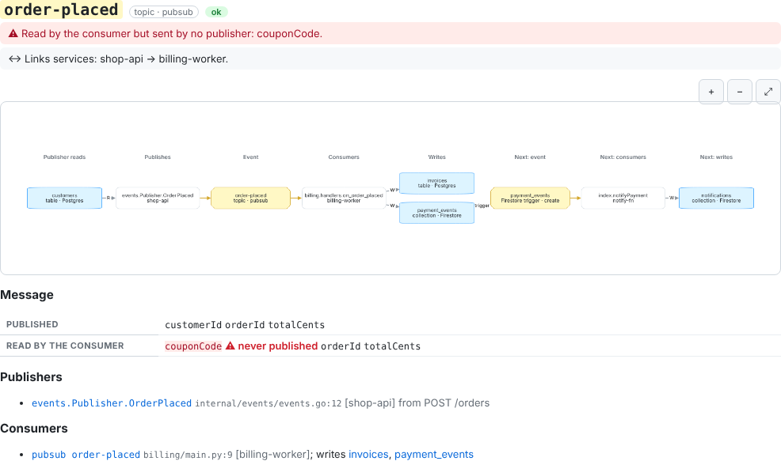
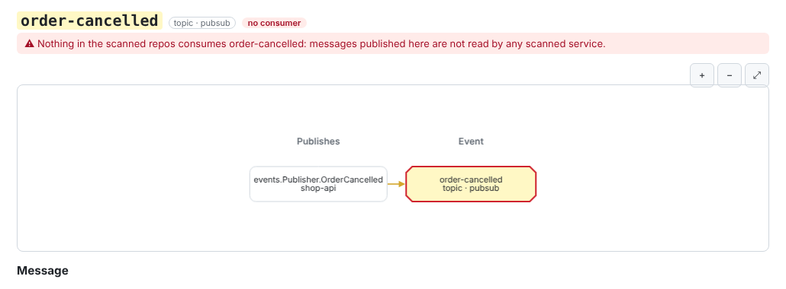

# `bizmap export`: architecture and queue flows

*Unreleased.*

The map and `trace` answer questions about one entity. These two views explain
the whole system at a glance: how services connect to stores and queues, and
how each queue works end to end.

```bash
bizmap export --graph bizmap.graph.json --format html --out bizmap.html   # #/architecture, #/queues, #/topic/<name>
bizmap export --graph bizmap.graph.json --format mermaid                  # bizmap-architecture.md, for GitHub
bizmap report --graph bizmap.graph.json --mermaid                         # the report, then the same diagrams
```

The screenshots use the fictional workspace from the tests
(`tests/fixtures/arch_demo.py`):

- `shop-api`: Go, Postgres `orders`, `customers` and `order_items`. It
  publishes `order-placed` and `order-cancelled`.
- `shop-web`: TS, calls `shop-api` over HTTP.
- `billing-worker`: Python. It consumes `order-placed` and writes `invoices`
  (Postgres) and `payment_events` (Firestore).
- `notify-fn`: a Cloud Function triggered by `payment_events`. It writes
  `notifications`.

Nothing consumes `order-cancelled`.

## Architecture (`#/architecture`)

Find it in the side menu or in the *Architecture* card on the start screen.



- **Columns, left to right**: front ends → APIs / services → topics → workers /
  functions → stores. A service's column comes from what it exposes: HTTP
  routes make it an API, only consumers / triggers / jobs make it a worker,
  and a JS/TS code base that calls APIs is a front end.
- **Stores, not tables**: each store (Postgres, Firestore, SQL Server…) is a
  single box that shows its number of tables / collections. Click it to list
  them with a filter. A store with up to 40 tables can also be expanded in the
  drawing.
- **Lines are aggregated per pair**:
  - service → store, labelled `R`, `W` or `RW`;
  - service → topic (*publishes*);
  - topic → consumer;
  - front end → API (*HTTP*);
  - store → function, for a Firestore trigger.

  Each line shows the number of accesses behind it, and its width grows with
  that number. A line is **dashed** when every link behind it is heuristic,
  as elsewhere in the page.
- **Click a line** to see the functions behind it (`orders.Service.PlaceOrder →
  orders W`, with `file:line`), each linking to its page.
- **Click a box** to see a service's links. A topic box opens its flow.
- **Stable layout**: the export computes the positions (layered columns,
  ordered by their neighbours), so the same graph always gives the same
  drawing. No new library: the page draws them with the Cytoscape it already
  embeds. A line that skips columns runs at right angles, between the boxes of
  the topic and worker columns.

With about 15 services and 800 tables the drawing still has one box per
service, topic and store. The page grows taller and scrolls; use the + / − /
fit buttons to zoom.



## Queues and events (`#/queues`)

Every **event source** is listed with its publishers, consumers and a status:
*ok*, *no consumer* or *no publisher*. A ⚠ *Message* tag means the consumer
reads a field no publisher sends. The sources are:

- topics and queues (Pub/Sub, Celery, RQ…);
- **Firestore triggers**: the collection is the source and the code that
  writes it is the publisher;
- **scheduled jobs**.



## One flow (`#/topic/<name>`)

The flow reads left to right:

1. what the publisher reads (the data reached by the route or job that calls
   it);
2. the publishing function and its service;
3. the topic;
4. the consumers;
5. what they write;
6. then the **next events**, up to 3 hops: a Firestore trigger on a collection
   the consumer writes (`payment_events → notify-fn → notifications`), or a
   topic the consumer publishes to.



- **Message**: when the scan saw them, the fields the publisher sends and the
  fields the consumer reads (`dataflow_in`). A field that is read but never
  published is flagged: `couponCode` above.
- **Warnings**:
  - *no consumer*: nothing in the scanned repos reads the topic;
  - *no publisher*: nothing in the scanned repos sends to it (for a Firestore
    trigger, nothing writes the collection);
  - *links services*: publisher and consumer live in different services.



`#/topic/<name>` takes the topic name, `firestore:<collection>`,
`cron:<job>` or the queue's node id, so the links from the search and the
map keep working.

## Mermaid, for GitHub

`bizmap export --format mermaid` writes Markdown that GitHub renders:

- the architecture, as a `flowchart LR` with one subgraph per column;
- a table of every event source;
- one `flowchart LR` per flow, with its warnings and message fields.

`bizmap report --mermaid` prints the same after the coverage report.
`--mermaid` cannot be combined with `--redact` or `--json`, because the
diagrams print names.

The **PR comment** (`bizmap impact`, the GitHub Action) adds an *Event flow*
section when a changed function publishes to a topic, consumes one or handles
a trigger, including through its calls (changing `orders.Service.Cancel`
brings `order-cancelled`). It shows at most two flows, those with a problem
first, and opens them when there is a warning. `--no-mermaid` keeps the notes
and drops the diagram.

## Limits

- **Publishers and consumers**: they come from the graph's `enqueues` and
  `triggers` edges. A topic whose name is built at runtime is not drawn and
  stays under *unresolved links*.
- **Message fields**: they come only from what the scan records:
  - fields on an `enqueues` edge (JS/TS publishes);
  - the producer's `dataflow_out`;
  - the consumer's `dataflow_in`;
  - for Firestore, the fields of the writes and the trigger's reads.

  When none of these exist, the page says the fields were not seen.
- **Hidden files**: tests and helpers (*Show details → tests and helpers*)
  are left out of both views.
