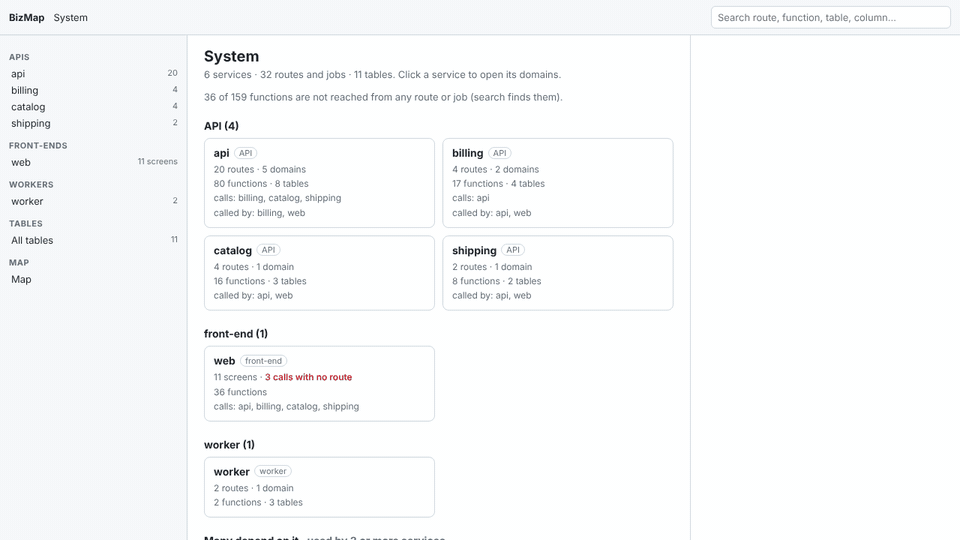

# `bizmap export`

*Requires bizmap 0.5.0+; the reading layout (domains, call trees, screens) since 0.6.0; API docs since 0.7.0.*



```bash
bizmap scan . --out bizmap.graph.json            # or a --discover / registry-merged graph
bizmap export --graph bizmap.graph.json --format html --out bizmap.html
bizmap export --format html --lang pt-BR         # page in Brazilian Portuguese
```

`--format html` writes **one self-contained file**: the graph and every library
are inside it. It opens with a double click, works offline, and can be attached
to an e-mail or a ticket. Nothing is fetched from a CDN or a server.

`--format llm` (a compact text overview for an AI assistant) is not available yet.

## API docs: what each route receives and returns

A domain page reads like Swagger / Redoc: one line per endpoint (method, path,
summary). Open one to see its description, parameters, the **JSON request
body**, each **response with its JSON**, the screens that use it, the data it
reads and writes in one sentence, and — only if you ask — **See in code** (the
call tree).

The docs come from, best first:

1. **An OpenAPI / Swagger file**: `swag init`'s `docs/swagger.json`, FastAPI's
   `openapi.json` (Swagger 2.0 or OpenAPI 3, JSON or YAML). It brings the
   fields of every request and response. `bizmap export` finds it next to each
   repo — `<repo>/docs/swagger.json`, `<repo>/docs/openapi.json`,
   `<repo>/openapi.json`, `<repo>/swagger.json`, `<repo>/api/openapi.json` (or
   `.yaml`) under the current directory, else every spec in the repo's
   `openapi/`, `docs/`, `api/`, `spec/` or `specs/` folder (one per area). The
   repo folder is the graph's `repo_roots` entry when it has one, else the
   service name. A spec found this way that cannot be read is skipped with a
   note; `bizmap export` prints the specs it used (`API docs: 2 specs (…)`).
   Or give them explicitly (repeatable; a bad file or an unknown service is
   then an error):

    ```bash
    bizmap export --openapi api=../api/docs/swagger.json --openapi billing=openapi.json
    ```

    ```yaml
    export:
      openapi:
        api: ../api/docs/swagger.json     # relative to bizmap.yaml
    ```

   When the spec has no description, the handler's comment or docstring is
   used (FastAPI's automatic summary comes from the function name; the
   docstring has the text). Query parameters show their enum and default.

2. **swag comments** above a Go handler (`@Summary`, `@Description`, `@Tags`,
   `@Param`, `@Success`, `@Failure`, `@Router`) — already in the graph. They
   give the summary, parameters and the *names* of the request and response
   types; their fields need the spec file.
3. **The handler's comment**: its first sentence becomes the summary.

Routes are matched by method and path (`{id}`, `:id` and `<id>` alike), with the
spec's base path (`basePath`, `servers[0].url`). Domains follow the API's own
**tags** (`@Tags`, OpenAPI `tags`); routes without docs join the tag named
like the first matching segment of their path (`/api/v1/products/:id` →
`products`), and a tag with more than 80 routes is split into sections
(`client · delivery`).

## Reading the page

The page reads the system like a book: overview first, detail on click. It
never draws the whole graph.

| Level | What you see |
| --- | --- |
| **System** | One card per service: API, front-end, worker or library, with routes, domains, tables, who it calls and who calls it. "Many depend on it": services and tables used by 3 or more services. |
| **Service** | Its **domains**: routes grouped by path (`/projects`, `/projects/tasks`…), with how many routes and functions, the tables they read and write, and how many callers use them. Then, for any service: its screens (front-ends), the tables it reads and writes itself, and its **code by folder** (functions, HTTP calls, tables) — for a library or a client with no routes, that is its whole page. A folder opens the list of its functions. |
| **Domain** | The endpoints, like API docs: method, path, summary; open one for parameters, request and response JSON, screens that use it and its data (see above). |
| **Route** (See in code) | Its **call tree**: the handler, the functions it calls, and so on, one line per function with its folder and the tables (and columns) it reads (R) or writes (W). Each node opens on click; a function already shown, or one that calls back into the path, is marked instead of repeated. |
| **Data** | A table's page: columns and types, the functions that read or write it (by service, with columns and SQL operations), and the routes and jobs that reach it. |

The right panel shows what you clicked: `file:line`, the comment above the
function (`why`), parameters, what it calls and who calls it, the tables it
reads and writes itself and through the functions it calls, its HTTP calls, and
— for a route — **who consumes it** (front-end screens and other services).

Parameters come from the route path (`:id`, `{id}`, `<id>`, `[id]`). When the
graph has `params` / `returns` on a function, the panel shows them too.

### Front-ends and API calls

A service whose code is mostly TS/JS/Vue/Svelte and that calls APIs
(`calls_http` or `unresolved_http`) is listed as a **front-end** when it has UI
files (`.tsx`, `.jsx`, `.vue`, `.svelte`, a `pages/`, `screens/` or
`components/` folder) or no routes of its own — a Vite app made of `.ts`
files counts.

- **Screens** are the UI files that reach an API call through the calls the
  scan follows: a page → a hook → the API client → the route. Each screen lists
  the routes it uses and the client functions it goes through. In a front-end
  with no UI files, the files that make the calls are the screens.
- **API client code** lists the files whose functions call an API (the client
  layer) — for every service, not only front-ends — with the routes each one
  reaches and the screens that use it. A client file with no screen linked is
  usually called through a function reference (a hook's `queryFn`), which the
  call graph does not follow.
- **Calls with no route** lists the calls that matched no scanned route
  (`unresolved_http`), for every service, by reason, with what each reason
  means.
- Each API route lists **who consumes it**: the screens first, then the calling
  functions.
- Links matched by heuristic (a path found in the code matched to a route by
  its end) are dashed and marked *likely*; links from a full URL are solid.
- Tests, mocks, fixtures, type declarations (`.d.ts`) and generated code
  (`generated/`) call APIs too, but they are not who uses a route: they are
  left out of screens, client code, consumers and counts, and the page says
  how many calls it left out.

Search (top right) finds routes, functions, tables and columns; links can be
shared (`#/r/…`, `#/t/…`) and the back button works. **Map** keeps the service
graph (services and the HTTP links between them).

## Domains

Routes are grouped by the first useful path segment. Skipped: generic segments
(`api`, `v1`, `v2`…, `rest`, `public`, `internal`, `graphql`, `rpc`), path
parameters, a prefix every route of the service shares, and a first segment
at least 70% of the routes share (`/svc/…`). A group that is
too large (more than 80 routes, or more than 35% of a service with over 30
routes) is split by the next segment into sections (`/projects/tasks`); a
section with fewer than 3 routes stays in its parent. Groups with fewer than 3
routes go to **other**. A service with 12 routes or fewer has a single domain.
Jobs, workers, tasks and events are grouped by kind.

Fix or rename groups in `bizmap.yaml` (read from `--config`, else
`./bizmap.yaml`; only `bizmap export` reads `export:`):

```yaml
export:
  domains_by: path                  # or `folder`: group by the handler's directory
  domains:
    api:                            # service name; "*" applies to every service
      projects: [/projects, /v2/projects]
      billing: [/invoices, "folder:internal/billing/"]
```

Rules from `bizmap.yaml` are applied first (longest prefix wins); the rest is
grouped automatically. API tags (above) come before automatic grouping.

## Services

A service is a **repository** by default: the `repo/` prefix of ids in a
merged or joint graph, else the graph's `repo`. Tables of a shared `database:`
belong to no service, so several services can point at the same table.

A monorepo can be split into several services:

```yaml
export:
  services:
    orders: [services/orders/, libs/orders/]
    billing: services/billing/
    admin: "api:cmd/admin/"     # in a multi-repo graph: only in repo `api`
```

A node whose evidence file starts with one of the prefixes goes to that
service (longest prefix wins); everything else stays in its repo.

## Large graphs

Only a small index is read when the page opens. Each domain, front-end, batch
of tables and folder of unreached functions is a separate JSON block in the
same file, read the first time it is opened; search reads the name list on
the first keystroke. Derived (call-propagated) data edges are not shipped: the
page recomputes them from the call tree.

On a synthetic graph shaped like a 16-repo `--discover` (107k nodes, 628k
edges), measured in headless Chrome: a 31 MB file generated in about 4 s, an
index of about 0.3 MB, the page ready in about 0.4 s, and every level (service,
domain, route tree, function, table, screens) opened in under 100 ms.
`pytest -m perf` regenerates that graph and checks the generation time, the
index size and the largest block.

Try it on the fictional example (its `api/openapi.json` is found next to it):

```bash
cd examples/export && bizmap export --graph shop.graph.json --out shop.html
```

## What the page is made of

| Part | What | License |
| --- | --- | --- |
| [Cytoscape.js](https://js.cytoscape.org/) 3.34.1 | the service map (inlined, minified) | MIT (notice kept at the top of the inlined file) |
| `export/book.js` | BizMap's own plain JavaScript: no framework, no build step | MIT (BizMap) |
| `export/template.html` | the page and its CSS | MIT (BizMap) |

`bizmap export` fills the template with these files and the graph data. No
Python dependency is added and nothing is downloaded when the page is
generated or opened.
