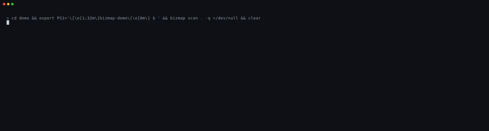

# `bizmap report`

How much of a codebase BizMap understood: entrypoints that reach a table,
HTTP links matched and unresolved (by reason, with a hint for each), how
links were derived, and confidence.

```bash
bizmap report [PATH ...] [options]
```

With `PATH` it scans in memory (nothing is written); without, it reads
`--graph` (default `bizmap.graph.json`).

{ .shot }

```text
$ bizmap report
bizmap report (graph 0.4.1)
repos: payments, shop

entrypoints: 10  reaching a table/collection: 10 (100.0%)
  http              10 / 10

http links: 2  (cross-repo 2)
  via traced_client  2
unresolved http: 0

data links by derivation: db_trigger:trg_orders_status_history 6

edges by confidence: exact 45, inferred 94
data links: direct (exact 41, inferred 11), copied to callers/entrypoints 58, via DB triggers 6
unresolved calls: 0
```

When the graph has [`feeds`](../graph-schema.md#data-flow-between-tables-feeds)
edges, a **data flow between databases** section follows: how many `feeds`,
how many have columns mapped, the exact / heuristic share, and one line per
database pair:

```text
data flow between databases: 2 feeds, 2 with columns mapped, 6 column mappings (exact 4, heuristic 2, 67% exact)
  orders_db -> orders_db: 1 table, 2 columns (exact 0, heuristic 2)
  orders_db -> summary_db: 1 table, 4 columns (exact 4, heuristic 0)
```

Use it on a new codebase before trusting `why` or the PR comment: a low
"reaching a table" share or many unresolved HTTP calls usually means a
missing [`services:`](../configuration.md#services) entry, a service that
was not scanned, or a framework BizMap does not know yet.

## Options

| Option | Meaning |
| --- | --- |
| `--graph PATH` | Graph to report on (ignored when `PATH` roots are given). |
| `--config PATH` | `bizmap.yaml` for `PATH` scans. |
| `--json` | The report as JSON. |
| `--limit N` | Max rows per list (default 20). |
| `--cross-service` | Count entrypoints that reach data only through another scanned service (`calls_http`) as reaching data. |
| `--mermaid` | Append the architecture and each queue / trigger flow as Mermaid diagrams ([details](export-views.md#mermaid-for-github)). Not with `--redact` or `--json`. |
| `--redact` | Replace every name, route, table, URL, env key and file with a salted hash. |
| `--salt TEXT` | Salt for `--redact` (or env `BIZMAP_REDACT_SALT`). Same salt, comparable runs. |
| `--salt-file PATH` | Read the salt from this file, creating a private random one (mode 0600) on first use. |

## Sharing a report from private code

```bash
bizmap report ./svc-a ./svc-b --redact --salt-file ~/.bizmap-salt --json
```

Only counts, edge types, entrypoint kinds and reasons stay readable, so the
report can be attached to an issue without sharing code. Without a salt each
run uses a random one and hashes differ between runs.
