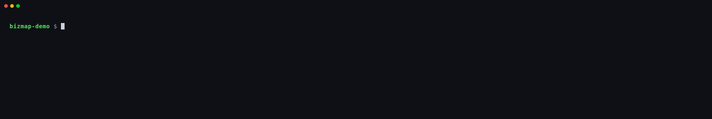

# `bizmap scan`

Reads source code and SQL and writes the lineage graph.

```bash
bizmap scan [PATH ...] [options]
```

- **One path** — one repository (or a [workspace](../configuration.md#repos)
  whose `bizmap.yaml` lists `repos:`).
- **Several paths** — scanned jointly: one graph, HTTP calls between them
  matched, tables shared when they declare the same `database:`.
- **No path** with `--discover DIR` — see [scan --discover](../discover.md).

```bash
bizmap scan .                                # this repo → bizmap.graph.json
bizmap scan . --mermaid                      # + bizmap.graph.mmd
bizmap scan ./web ./api ./billing --out merged.json
bizmap scan --discover ~/work --list         # what would be scanned, and why
```

## Options

| Option | Meaning |
| --- | --- |
| `--out PATH` | Where to write the graph JSON (default `bizmap.graph.json`). |
| `--mermaid` | Also write a Mermaid flowchart next to the JSON (`.mmd`): entrypoint → table rollup, plus cross-service `calls_http` in joint scans. |
| `--mermaid-focus TABLE` | Restrict the diagram to one table or view and its neighbourhood. |
| `--mermaid-limit N` | Maximum nodes in the diagram (default 80). |
| `--expand-star` | Expand `SELECT *` to every schema column (off by default: table-level). |
| `--rules PATH` | Extra [YAML detector rules](../detector-rules.md), file or directory (repeatable). |
| `--config PATH` | Path to `bizmap.yaml` (default: scan root, then git top level). |
| `--exclude GLOB` | Exclude glob (repeatable), added to `exclude:` in `bizmap.yaml`. |
| `-v`, `--verbose` | List every unresolved HTTP call and warning (default: counts and the top 10). |
| `-q`, `--quiet` | No progress lines on stderr (they only appear for scans longer than a few seconds). |
| `--profile` | Print phase timings (parse, resolve, sql, propagate) to stderr. |
| `--discover [DIR]` | Find the git repos under `DIR` (default: the current folder) and scan them jointly. With it: `--list`, `--json`, `--depth N`, `--include GLOB`, `--prefer PATH`. See [scan --discover](../discover.md). |

## What it prints

{ .shot }

```text
wrote bizmap.graph.json  (59 nodes, 139 edges)
wrote bizmap.graph.mmd
```

When something could not be linked, the summary says what and why. Scanning
only the `shop` service of a two-service workspace (an earlier version of the
demo), the call to the payments service has no target:

```text
wrote /tmp/shop.json  (46 nodes, 119 edges)
1 unresolved HTTP calls: target_not_scanned=1
  POST {PAYMENTS_URL}/charges
```

Each unresolved call has a reason: `target_not_scanned` (the URL is complete
but no scanned route matches — scan the other service too), `base_unknown`
(the path is known, the base URL is not — map it in
[`services:`](../configuration.md#services)), `path_dynamic` (the path is
built at runtime), `client_unknown` (the HTTP client could not be traced).
When an env var or host shows up, `scan` prints a ready-to-paste `services:`
hint.

It also names what it skipped (generated code, build caches, `.gitignore`d
paths) — see [`scan:` in the configuration](../configuration.md#exclude-and-scan).

**Nested repos and worktrees are skipped.** A directory with its own `.git`
(a directory, or the `.git` file of a `git worktree`) inside the scanned repo
is not walked, so an old worktree or a vendored clone does not duplicate
every node:

```text
skipped: 1 nested repos/worktrees  (scan: include / gitignore / skip_generated in bizmap.yaml)
  nested repos/worktrees: shop-functions:.worktrees/old
```

To scan one anyway, list it in `bizmap.yaml`:

```yaml
scan:
  include: [".worktrees/old"]
```

To scan several repos side by side, use `bizmap scan --discover .` or list
them (`bizmap scan ./orders-api ./shop-web`) instead.

## Output

- `bizmap.graph.json` — the graph: nodes, edges with `file:line` evidence and
  confidence, the reconstructed schema. Format: [Graph format](../graph-schema.md).
- `bizmap.graph.mmd` — with `--mermaid`; GitHub renders it in Markdown files
  and PR descriptions inside a ` ```mermaid ` block.

The output is deterministic: the same input gives byte-identical JSON (except
`generated_at`), so the graph can be committed and diffed.

### Generated files and what to ignore

| File | Written by | Where | Commit it? |
| --- | --- | --- | --- |
| `bizmap.graph.json` | `bizmap scan` (`--out` to change) | the folder you scan from | Only on purpose — it can reach tens of MB on a big repo (GitHub refuses files over 100 MB). |
| `bizmap.graph.mmd` | `bizmap scan --mermaid` | next to the graph | Usually not. |
| `bizmap.html` | `bizmap export` (`--out`) | the current folder | Usually not; share the file instead. |
| index cache (`*.idx`) | `who-writes` / `who-reads` / `trace` | your user cache folder, **never the repo** | — |

When the scan writes a file inside a git repo that git does not ignore, it says
so once per file and prints the line to add:

```text
note: git does not ignore bizmap.graph.json (generated, can be large). Add to /work/orders-api/.gitignore:
  /bizmap.graph.json
```

A typical `.gitignore`:

```gitignore
/bizmap.graph.json
/bizmap.graph.mmd
/bizmap.html
# written by bizmap 0.13.1 next to the graph (no longer used): delete it
/bizmap.graph.idx
```

`BIZMAP_NO_GITIGNORE_HINT=1` silences the note (e.g. when you do commit the
graph).
