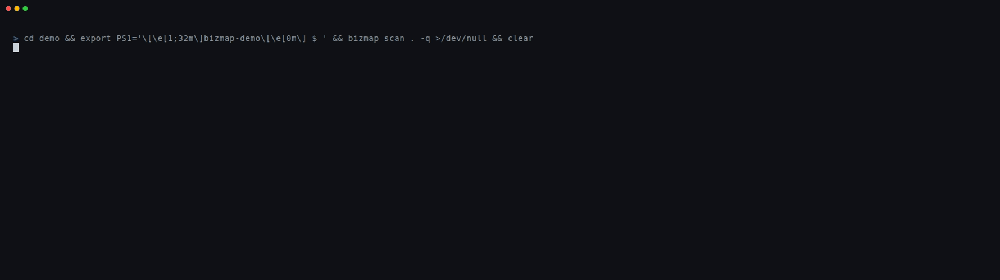

# `bizmap why`

Everything the graph knows about one column: who writes it, who reads it, what
triggers that code and which other service calls in.

```bash
bizmap why TABLE.COLUMN [--graph bizmap.graph.json]
```

{ .shot }

Run [`bizmap scan`](scan.md) first. In the [demo](../getting-started.md):

```text
$ bizmap why payments.status
column: payments.status (TEXT)

writers:
  [exact] payments/app.create_charge  (app.py:20 app.create_charge) — Open a charge for an order (called by the shop at checkout).
      triggered by payments/HTTP POST /charges — Open a charge for an order (called by the shop at checkout).
      invoked via HTTP from shop/src.payments.createCharge
  [exact] payments/app.provider_webhook  (app.py:45 app.provider_webhook) — The provider confirmed the charge: settle it and tell the shop the order is paid.
      triggered by payments/HTTP POST /webhooks/provider — The provider confirmed the charge: settle it and tell the shop the order is paid.

readers:
  [exact] payments/app.get_charge  (app.py:34 app.get_charge) — Charge status for the support dashboard.
      triggered by payments/HTTP GET /charges/{charge_id} — Charge status for the support dashboard.
```

How to read it:

- **`[exact]` / `[inferred]`** — the edge's confidence. `exact` is static SQL
  in that function; `inferred` was carried from a callee, a database trigger,
  `SELECT *`, an interface call. See [Confidence](../graph-schema.md#confidence).
- **`repo/function (file:line)`** — where the read or write happens. The text
  after `—` is the comment or docstring above the function: the *why*, in the
  code's own words.
- **`triggered by`** — the entrypoint that reaches it: HTTP route, scheduled
  job, queue consumer, database trigger, Firestore event.
- **`invoked via HTTP from`** — the function in *another* scanned service that
  calls that route.
- **`via db_trigger:NAME`** — the write happens inside a database trigger
  fired by this function's statement.
- **`defined/altered by`** — the database triggers and SQL functions whose
  definitions write the column (for a column written by a trigger).
- **`why:`** under the column name — from
  [`overrides.columns`](../configuration.md#overrides) in `bizmap.yaml`.

An unknown column prints `unknown column: …` and exits with status 1.
The MCP tool [`why_column`](../mcp.md#why_column) returns the same report.
