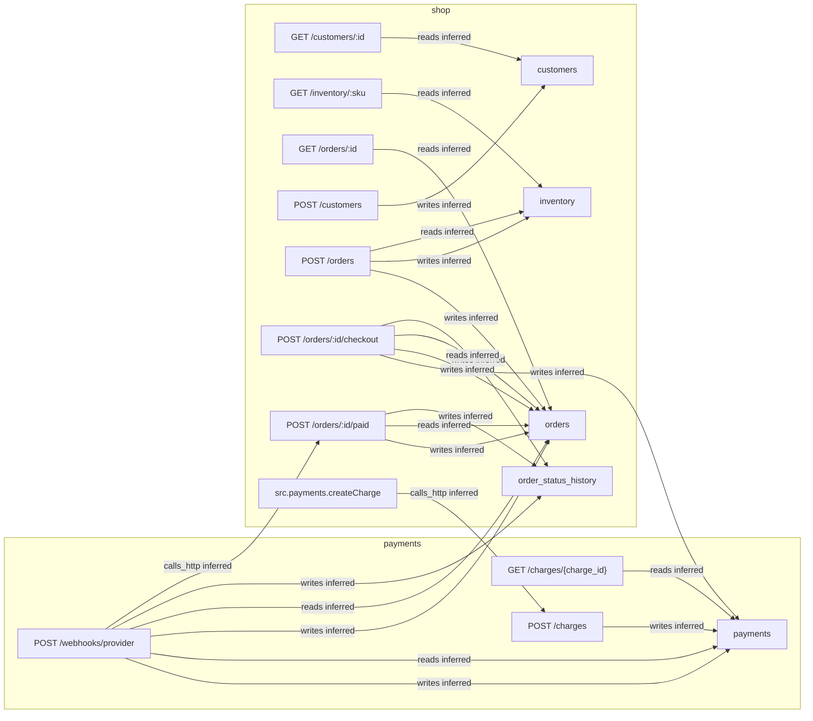

# Getting started

## Install

BizMap needs Python 3.11 or newer.

```bash
pipx install bizmap        # or: pip install bizmap
bizmap --version
```

[pipx](https://pipx.pypa.io/) installs it in its own environment and puts
`bizmap` on your `PATH`. Nothing else is required: no database connection, no
account, no network.

## Scan the demo

[bizmap-demo](https://github.com/lucas-simao/bizmap-demo) is a small,
fictional shop with two services that share one Postgres database:

```text
bizmap-demo/
├── bizmap.yaml          workspace: repos [shop, payments] + services
├── shop/                TypeScript + Express + pg
│   ├── src/             routes, orders, inventory, checkout, payments client
│   └── db/              schema.sql + migrations (a status-history trigger)
└── payments/            Python + FastAPI + SQLAlchemy
    ├── app.py           /charges, /webhooks/provider
    └── migrations/
```

At checkout the shop calls `POST /charges` on payments; when the payment
provider confirms, payments calls `POST /orders/:id/paid` back on the shop.
A database trigger records every change of `orders.status`.

```bash
git clone https://github.com/lucas-simao/bizmap-demo && cd bizmap-demo
bizmap scan . --mermaid
bizmap who-writes orders.status     # who writes this column, from which entrypoint
bizmap trace orders                 # where the data comes from and where it goes
bizmap why orders.status            # everything around the column at once
```

{ .shot }

`bizmap scan .` reads the workspace `bizmap.yaml`, scans `shop` and
`payments` together and writes `bizmap.graph.json` (plus
`bizmap.graph.mmd` with `--mermaid`). The questions then answer from that
file.

### Ask: who writes, who reads, trace

```bash
bizmap who-writes orders.status              # add --path for the full call chain
bizmap who-reads orders --format md          # text (default), md or json
bizmap trace orders --depth 2                # upstream and downstream
```

Each writer is shown as *entrypoint → (via N functions) → the function that
writes*, with the columns, the confidence, the repo and `file:line`. A name
that matches several things (a Firestore collection and a Postgres table both
called `orders`) lists the candidates instead of picking one, and every answer
ends with what could change it (unresolved names, URLs and queues). Details:
[who-writes / who-reads / trace](commands/query.md).

### Open the HTML page

```bash
bizmap export --format html --out bizmap.html     # --lang pt-BR
```

One offline file that opens on *who writes / reads X?*: type `orders.status`,
press Enter, and the writers are listed the same way as on the command line.
Below it: a summary strip, findings (an unexpected writer, tables written by
several services, names built at runtime, orphan functions), a services ×
tables matrix and a **Mapa** tab around one entity. See
[the start screen](commands/export-home.md).

{ .shot }

### Everything around one column: `why`

`bizmap why orders.status` prints every writer, reader, trigger and caller at
once:

- three functions **write** `orders.status`, each with `file:line` and the
  comment above it;
- `markPaid` is **triggered by** `POST /orders/:id/paid`, which is
  **invoked via HTTP from** `payments/app.provider_webhook` — a different
  service, in a different language;
- `[exact]` is SQL in that function; `[inferred]` was carried up to the route
  handler that calls it.

The trigger shows up on the table it writes:

```text
$ bizmap why order_status_history.new_status
column: order_status_history.new_status (TEXT)

writers:
  [inferred] shop/src.orders.markPaid  (src/orders.ts:29 src.orders.markPaid) via db_trigger:trg_orders_status_history — Marks an order as paid.
      triggered by shop/HTTP POST /orders/:id/paid
      invoked via HTTP from payments/app.provider_webhook
  ...

defined/altered by:
  [exact] db trigger trg_orders_status_history on orders  (db/migrations/001_order_status_history.sql:18 trg_orders_status_history)
  [exact] shop/log_order_status  (db/migrations/001_order_status_history.sql:10 log_order_status)
```

An `UPDATE orders SET status = …` in the shop is enough for BizMap to know
that `order_status_history` is written too, and by which routes.

## Check what it understood

```bash
bizmap report
```

{ .shot }

All 10 routes reach a table, both cross-service calls are linked, nothing is
unresolved. On your own code, start here: the report says what BizMap could
not link and why.

## The diagram

`--mermaid` writes an entrypoint → table rollup, one box per service, with
the HTTP calls between them. This is `bizmap.graph.mmd` for the demo, as written:



## Your own code

```bash
cd path/to/your/repo
bizmap scan .                 # → bizmap.graph.json
bizmap report                 # how much was understood
bizmap why users.email        # any table.column
```

Several services:

```bash
bizmap scan ./web ./api ./billing           # jointly, calls between them linked
bizmap scan --discover ~/work --list        # a folder full of clones and worktrees
```

Then:

- tell BizMap which env var points at which service, and which repos share a
  database: [Configuration](configuration.md);
- comment on every pull request: [GitHub Action](github-action.md);
- let your coding agent ask the graph: [MCP server](mcp.md).
