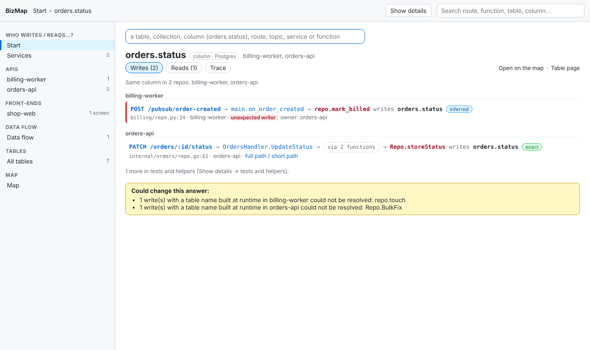
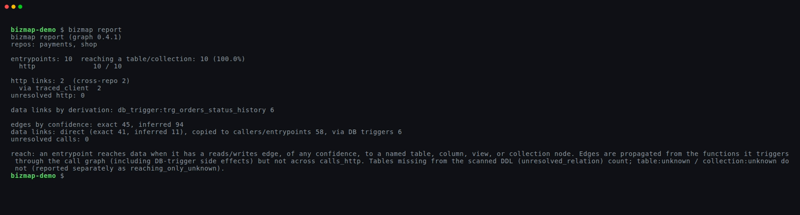

# Getting started

## Install

BizMap needs Python 3.11 or newer.

```bash
pipx install bizmap        # or: pip install bizmap
bizmap --version
```

[pipx](https://pipx.pypa.io/) installs it in its own environment and puts
`bizmap` on your `PATH`. Nothing else is required: no database connection, no
account, no network.

## Scan the demo

**Northwind Outfitters** is a fictional shop split in two repos:

- [bizmap-demo-api](https://github.com/lucas-simao/bizmap-demo-api): Go (Echo) on Postgres (`customers`, `products`,
  `orders`, `order_items`, `payments`, `shipments`), and it writes every status
  change to the Firestore collection `order_events`. The business rules live
  in plain functions: discounts in `pricing.go`, stock reservation and payment
  in `repo.go`, the order states in `status.go`, an expiry job in `jobs.go`.
- [bizmap-demo-web](https://github.com/lucas-simao/bizmap-demo-web): a TypeScript storefront (axios + Firebase). Its
  screens call the API over HTTP, read `order_events` live and add notes to it;
  a Cloud Function triggered by `order_events` writes `notifications`.

```bash
git clone https://github.com/lucas-simao/bizmap-demo-api && cd bizmap-demo-api
git clone https://github.com/lucas-simao/bizmap-demo-web .bizmap/web
bizmap scan .bizmap --out bizmap.graph.json   # the two-repo workspace in .bizmap/bizmap.yaml
bizmap who-writes orders.status               # who writes this column, from which entrypoint
bizmap trace order_events                     # where the data comes from and where it goes
bizmap why orders.discount_cents              # everything around the column at once
```

`bizmap scan .bizmap` reads the workspace `bizmap.yaml`, scans both repos
together, matches each storefront call to the Go route it hits, and writes
`bizmap.graph.json`. The questions then answer from that file. Prefer not to
install anything yet? The demo publishes its [live map](https://lucas-simao.github.io/bizmap-demo-api/).

### Ask: who writes, who reads, trace

```bash
bizmap who-writes orders.status              # add --path for the full call chain
bizmap who-reads orders --format md          # text (default), md or json
bizmap trace orders --depth 2                # upstream and downstream
```

Each writer is shown as *entrypoint → (via N functions) → the function that
writes*, with the columns, the confidence, the repo and `file:line`. A name
that matches several things (a Firestore collection and a Postgres table both
called `orders`) lists the candidates instead of picking one, and every answer
ends with what could change it (unresolved names, URLs and queues). Details:
[who-writes / who-reads / trace](commands/query.md).

### Open the HTML page

```bash
bizmap export --format html --out bizmap.html     # --lang pt-BR
```

One offline file that opens on *who writes / reads X?*: type `orders.status`,
press Enter, and the writers are listed the same way as on the command line.
Below it: a summary strip, findings (an unexpected writer, tables written by
several services, names built at runtime, orphan functions), a services ×
tables matrix and a **Mapa** tab around one entity. See
[the start screen](commands/export-home.md).

{ .shot }

### Everything around one column: `why`

`bizmap why orders.discount_cents` prints every writer, reader, trigger and
caller at once, each with `file:line`. On the demo the writer is the pricing
rule in the Go API, and the chain ends in the other repo: *invoked via HTTP
from web/src.screens.checkout.placeOrder*, the storefront function behind the
checkout button. `[exact]` is the SQL in that function; `[inferred]` was
carried up to the route that calls it.

{ .shot }

## Check what it understood

```bash
bizmap report
```

{ .shot }

How many entrypoints reach a table, how many HTTP calls between services were
linked, and what is unresolved. On your own code, start here: the report says
what BizMap could not link and why.

## The diagram

`bizmap scan --mermaid` also writes `bizmap.graph.mmd`: an entrypoint → table
rollup, one box per service, with the HTTP calls between them. For browsing,
the [HTML page](commands/export-home.md) is usually the better view.

## Your own code

```bash
cd path/to/your/repo
bizmap scan .                 # → bizmap.graph.json
bizmap report                 # how much was understood
bizmap why users.email        # any table.column
```

Several services:

```bash
bizmap scan ./web ./api ./billing           # jointly, calls between them linked
bizmap scan --discover ~/work --list        # a folder full of clones and worktrees
```

Then:

- tell BizMap which env var points at which service, and which repos share a
  database: [Configuration](configuration.md);
- comment on every pull request: [GitHub Action](github-action.md);
- let your coding agent ask the graph: [MCP server](mcp.md).
