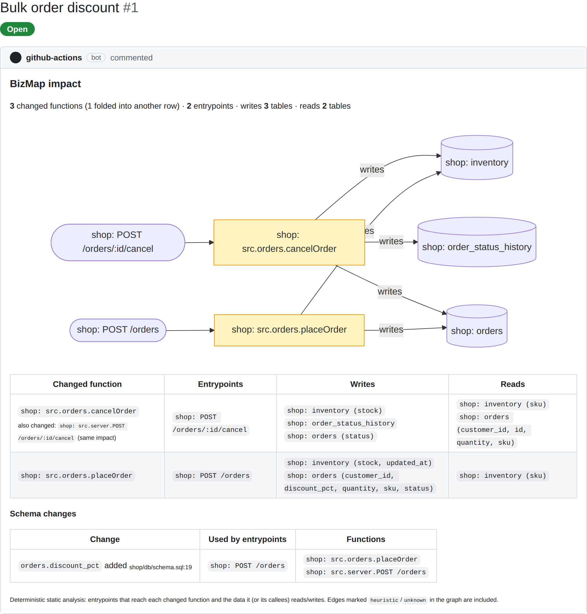
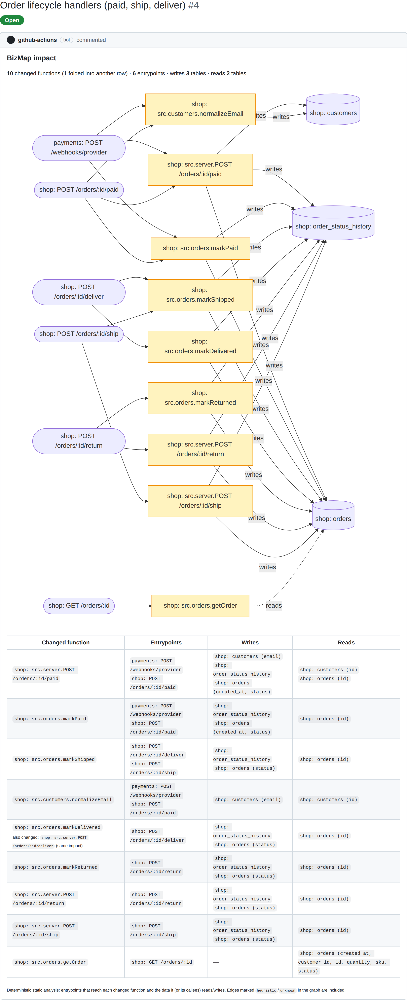
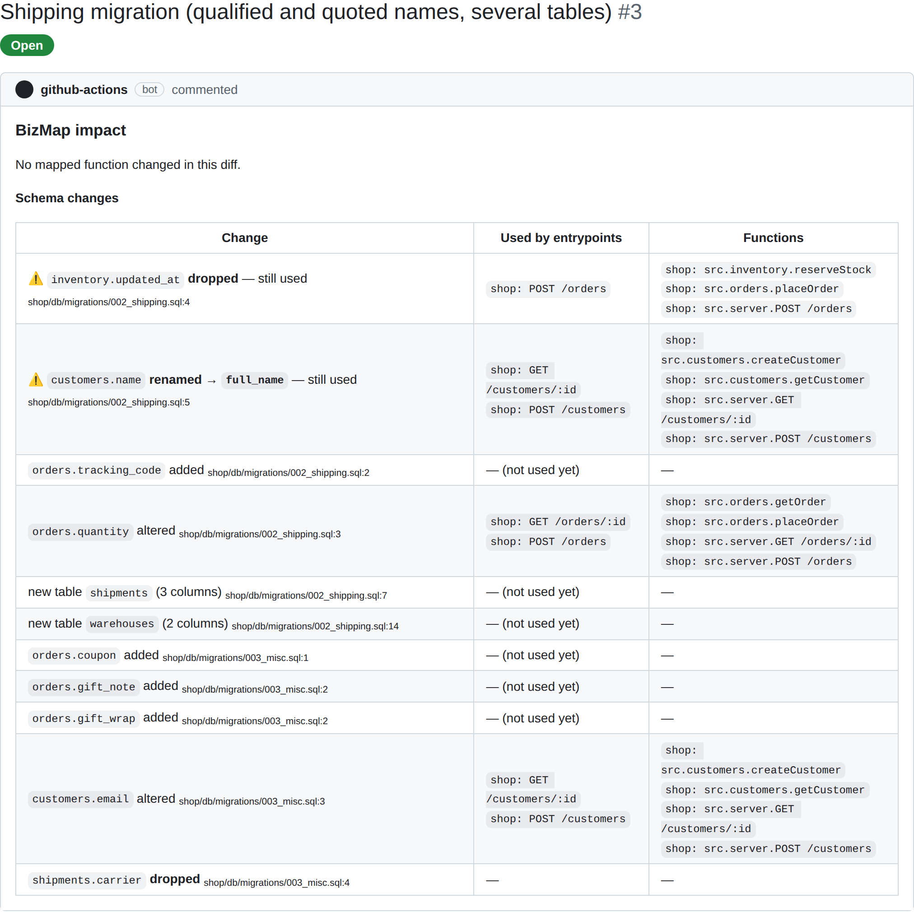

# GitHub Action

On every pull request, the Action scans the PR head, maps the diff onto the
graph and posts **one** comment — updated on each push — with the routes,
functions, tables and columns the change reaches, and a Mermaid diagram.

{ .shot width="760" }

## Setup

`.github/workflows/bizmap-impact.yml`:

```yaml
name: BizMap impact
on: pull_request            # not pull_request_target: never run PR code with a write token
permissions:
  contents: read
  pull-requests: write
concurrency:                # two quick pushes must not race to create two comments
  group: bizmap-impact-${{ github.event.pull_request.number }}
  cancel-in-progress: true
jobs:
  bizmap:
    runs-on: ubuntu-latest
    steps:
      - uses: actions/checkout@v4   # the base commit is fetched if missing; fetch-depth: 0 also works
      - uses: lucas-simao/bizmap@v0.5.0
        with:
          path: .            # or the workspace dir holding bizmap.yaml with `repos:`
```

Pin a release tag (or a commit SHA, for supply-chain hygiene:
`lucas-simao/bizmap@<sha> # v0.5.0`). The Action installs BizMap from that
same ref, so the CLI and the Action always match.

## See it running

[bizmap-demo](https://github.com/lucas-simao/bizmap-demo/pulls) keeps four
pull requests open as live examples:

| PR | What the comment shows |
| --- | --- |
| [#1 Bulk order discount](https://github.com/lucas-simao/bizmap-demo/pull/1) | A new route and a changed insert: columns written, stock touched. |
| [#2 Schema-only change](https://github.com/lucas-simao/bizmap-demo/pull/2) | No function changed; the columns added or changed and the routes that use them. |
| [#3 Shipping migration](https://github.com/lucas-simao/bizmap-demo/pull/3) | A migration that drops and renames columns still in use, flagged ⚠️. |
| [#4 Order lifecycle handlers](https://github.com/lucas-simao/bizmap-demo/pull/4) | Many handlers; one is reached from the **payments** service across HTTP. |

??? example "PR #4: a change reached from another service"

    { .shot }

??? example "PR #3: a migration that drops and renames columns still in use"

    { .shot }

## Inputs

| Input | Default | Meaning |
| --- | --- | --- |
| `path` | `.` | Directory to scan, relative to the repository root. A `bizmap.yaml` with `repos:` there scans a monorepo jointly. |
| `config` | — | Path to `bizmap.yaml`, when it is not in `path`. |
| `comment` | `"true"` | Post (or update) the PR comment. `"false"` only writes the job summary. |
| `comment-author` | `github-actions[bot]` | Login that owns the comment to update. Comments by anyone else are never edited. |
| `max-rows` | `"50"` | Max functions in the comment (the job summary lists all). |
| `fail-on-error` | `"false"` | Fail the job when BizMap itself fails. The check is advisory by default. |
| `python-version` | `"3.12"` | Python used to run BizMap. |
| `github-token` | `${{ github.token }}` | Token for the comment (needs `pull-requests: write`). |

## Outputs

| Output | Meaning |
| --- | --- |
| `markdown` | Path of the Markdown written to the comment. |
| `status` | `ok`, `skipped` or `failed`. |

## Behaviour

- **One comment per PR.** It carries a hidden marker and is edited on every
  push. If the comments cannot be listed, nothing is posted (no duplicates).
- **Size-safe.** At most `max-rows` functions, ranked by how many routes and
  tables they reach; the comment stays under GitHub's size limit and the
  workflow run summary has the full list.
- **Forks** get a read-only token, so they only get the job summary.
- **Failures are visible but advisory.** If the scan fails, the comment says so
  and links the log; the job fails only with `fail-on-error: "true"`.
- **Only the PR's own change.** The diff starts at the merge base, so commits
  that landed on the base branch meanwhile are not reported (also with
  `ref: <head sha>` checkouts).
- **Schema changes.** Changed `.sql` files (schema, migrations) are read: a
  column dropped or renamed while code still uses it is flagged ⚠️ with the
  routes that use it.

## Running it locally

The comment is exactly what [`bizmap impact`](commands/impact.md) prints:

```bash
bizmap scan . --out /tmp/head.json
git diff --unified=0 origin/main... | bizmap impact --graph /tmp/head.json
```
