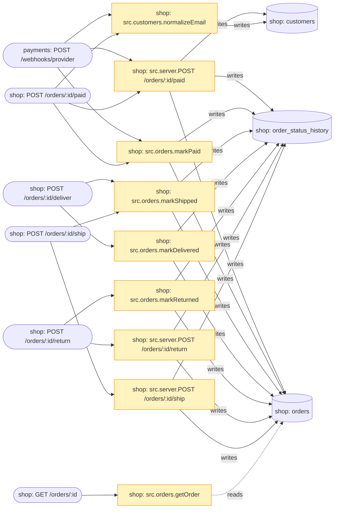

<!-- bizmap-impact -->
### BizMap impact

**10** changed functions (1 folded into another row) · **6** entrypoints · writes **3** tables · reads **2** tables

| Changed function | Entrypoints | Writes | Reads |
|---|---|---|---|
| `shop: src.server.POST /orders/:id/paid` | `payments: POST /webhooks/provider` `shop: POST /orders/:id/paid` | `shop: customers (email)` `shop: order_status_history` `shop: orders (created_at, status)` | `shop: customers (id)` `shop: orders (id)` |
| `shop: src.orders.markPaid` | `payments: POST /webhooks/provider` `shop: POST /orders/:id/paid` | `shop: order_status_history` `shop: orders (created_at, status)` | `shop: orders (id)` |
| `shop: src.orders.markShipped` | `shop: POST /orders/:id/deliver` `shop: POST /orders/:id/ship` | `shop: order_status_history` `shop: orders (status)` | `shop: orders (id)` |
| `shop: src.customers.normalizeEmail` | `payments: POST /webhooks/provider` `shop: POST /orders/:id/paid` | `shop: customers (email)` | `shop: customers (id)` |
| `shop: src.orders.markDelivered` also changed: `shop: src.server.POST /orders/:id/deliver` (same impact) | `shop: POST /orders/:id/deliver` | `shop: order_status_history` `shop: orders (status)` | `shop: orders (id)` |
| `shop: src.orders.markReturned` | `shop: POST /orders/:id/return` | `shop: order_status_history` `shop: orders (status)` | `shop: orders (id)` |
| `shop: src.server.POST /orders/:id/return` | `shop: POST /orders/:id/return` | `shop: order_status_history` `shop: orders (status)` | `shop: orders (id)` |
| `shop: src.server.POST /orders/:id/ship` | `shop: POST /orders/:id/ship` | `shop: order_status_history` `shop: orders (status)` | `shop: orders (id)` |
| `shop: src.orders.getOrder` | `shop: GET /orders/:id` | — | `shop: orders (created_at, customer_id, id, quantity, sku, status)` |

Deterministic static analysis: entrypoints that reach each changed function and the data it (or its callees) reads/writes. Edges marked `heuristic`/`unknown` in the graph are included.
