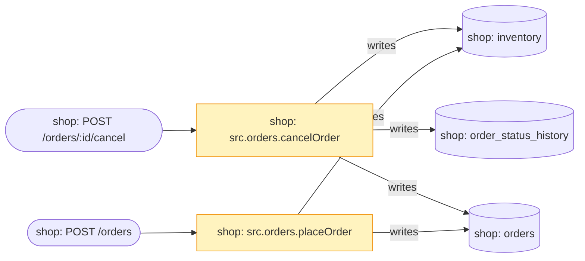

<!-- bizmap-impact -->
### BizMap impact

**3** changed functions (1 folded into another row) · **2** entrypoints · writes **3** tables · reads **2** tables

| Changed function | Entrypoints | Writes | Reads |
|---|---|---|---|
| `shop: src.orders.cancelOrder` also changed: `shop: src.server.POST /orders/:id/cancel` (same impact) | `shop: POST /orders/:id/cancel` | `shop: inventory (stock)` `shop: order_status_history` `shop: orders (status)` | `shop: inventory (sku)` `shop: orders (customer_id, id, quantity, sku)` |
| `shop: src.orders.placeOrder` | `shop: POST /orders` | `shop: inventory (stock, updated_at)` `shop: orders (customer_id, discount_pct, quantity, sku, status)` | `shop: inventory (sku)` |

**Schema changes**

| Change | Used by entrypoints | Functions |
|---|---|---|
| `orders.discount_pct` added shop/db/schema.sql:19 | `shop: POST /orders` | `shop: src.orders.placeOrder` `shop: src.server.POST /orders` |

Deterministic static analysis: entrypoints that reach each changed function and the data it (or its callees) reads/writes. Edges marked `heuristic`/`unknown` in the graph are included.
