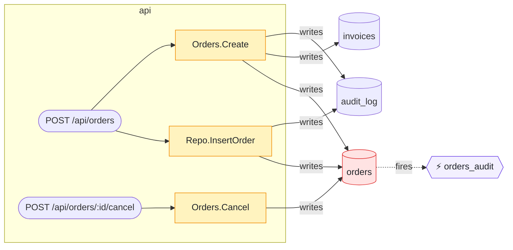

<!-- bizmap-impact -->
<!-- bizmap-risk: high -->
### BizMap impact · 🔴 High risk

**2** entrypoints (2 routes) · writes **3** tables · reads **1** table · **5** columns — from **3** changed functions

**Why high:**
- writes `orders`, used by 3 services (api, billing, worker)
- writes `orders`, which fires trigger `orders_audit`
- changes the handler of `api: POST /api/orders`, `api: POST /api/orders/:id/cancel`
- crosses services (api → billing, web → api)
- writes 3 tables reached from 2 entrypoints

<b>Diagram</b> · entrypoint → changed function → table

<b>Entrypoints</b> · 2

| Kind | Entrypoint | Where | Reaches changed |
|---|---|---|---|
| route | `api: POST /api/orders` · **handler changed** | [api/cmd/server.go:31](https://github.com/acme/shop/blob/0123456789abcdef0123456789abcdef01234567/api/cmd/server.go#L31) | `api: Orders.Create`, `api: Repo.InsertOrder` |
| route | `api: POST /api/orders/:id/cancel` · **handler changed** | [api/cmd/server.go:32](https://github.com/acme/shop/blob/0123456789abcdef0123456789abcdef01234567/api/cmd/server.go#L32) | `api: Orders.Cancel` |

<b>Data</b> · writes 3 · reads 1 · 5 columns

| Table | Writes | Reads | Changed functions |
|---|---|---|---|
| **`orders`** ⚠️ 3 services · ⚡ fires trigger | customer_id, status, total_cents | id | `api: Orders.Cancel`, `api: Orders.Create`, `api: Repo.InsertOrder` |
| **`audit_log`** | _table_ | — | `api: Orders.Create`, `api: Repo.InsertOrder` |
| **`invoices`** | amount_cents | — | `api: Orders.Create` |

<b>Triggers</b> · 1

| Trigger | On table | When | Fired by this change | Where |
|---|---|---|---|---|
| ⚡ `orders_audit` | `orders` | AFTER INSERT OR UPDATE | **yes** | [db/schema.sql:40](https://github.com/acme/shop/blob/0123456789abcdef0123456789abcdef01234567/db/schema.sql#L40) |

<b>Cross-service calls</b> · 2

| Services | Call | Match |
|---|---|---|
| **api** → **billing** | `api: Orders.Create` → `POST /charges` | heuristic · route literal |
| **web** → **api** | `web: checkout.submitOrder` → `POST /api/orders` | exact |

<b>Changed functions</b> · 3

**3** changed functions · **2** entrypoints · writes **3** tables · reads **1** table

| Changed function | Where | Entrypoints | Writes | Reads |
|---|---|---|---|---|
| `api: handlers.Orders.Create` | [api/handlers/orders.go:25](https://github.com/acme/shop/blob/0123456789abcdef0123456789abcdef01234567/api/handlers/orders.go#L25-L48) | `api: POST /api/orders` | `audit_log` `invoices (amount_cents)` `orders (customer_id, status, total_cents)` | — |
| `api: handlers.Orders.Cancel` | [api/handlers/orders.go:60](https://github.com/acme/shop/blob/0123456789abcdef0123456789abcdef01234567/api/handlers/orders.go#L60-L70) | `api: POST /api/orders/:id/cancel` | `orders (status)` | `orders (id)` |
| `api: repository.Repo.InsertOrder` | [api/repository/orders.go:15](https://github.com/acme/shop/blob/0123456789abcdef0123456789abcdef01234567/api/repository/orders.go#L15-L30) | `api: POST /api/orders` | `audit_log` `orders (customer_id, status, total_cents)` | — |

<b>Unresolved &amp; notes</b> · 3

- `api: Orders.Create` calls `POST ${FRAUD_URL}/score` — target not scanned
- 1 link in the reach is `heuristic`/`unknown` (route literals, dynamic SQL): included, worth a look
- 1 changed file outside any function: `api/README.md`

[BizMap](https://github.com/lucas-simao/bizmap/blob/main/docs/action.md) X.Y.Z · deterministic static analysis, no AI · commit [`0123456`](https://github.com/acme/shop/commit/0123456789abcdef0123456789abcdef01234567) · [run](https://github.com/acme/shop/actions/runs/42) · updated on every push
