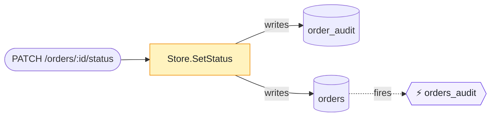

<!-- bizmap-impact -->
<!-- bizmap-risk: medium -->
### BizMap impact · 🟠 Medium risk

**1** entrypoint (1 route) · writes **2** tables · reads **0** tables · **1** column — from **1** changed function

**Why medium:**
- writes `orders`, which fires trigger `orders_audit`
- changes the handler of `PATCH /orders/:id/status`
- writes 2 tables reached from 1 entrypoint

<b>Diagram</b> · entrypoint → changed function → table

<b>Entrypoints</b> · 1

| Kind | Entrypoint | Where | Reaches changed |
|---|---|---|---|
| route | `PATCH /orders/:id/status` · **handler changed** | [main.go:5](https://github.com/acme/shop/blob/0123456789abcdef0123456789abcdef01234567/main.go#L5) | `Store.SetStatus` |

<b>Data</b> · writes 2 · reads 0 · 1 column

| Table | Writes | Reads | Changed functions |
|---|---|---|---|
| **`orders`** ⚡ fires trigger | status | — | `Store.SetStatus` |
| **`order_audit`** | _table_ | — | `Store.SetStatus` |

<b>Triggers</b> · 1

| Trigger | On table | When | Fired by this change | Where |
|---|---|---|---|---|
| ⚡ `orders_audit` | `orders` | AFTER UPDATE OF status | **yes** | [schema.sql:4](https://github.com/acme/shop/blob/0123456789abcdef0123456789abcdef01234567/schema.sql#L4) |

<b>Changed functions</b> · 1

**1** changed function · **1** entrypoint · writes **2** tables · reads **0** tables

| Changed function | Where | Entrypoints | Writes | Reads |
|---|---|---|---|---|
| `store.Store.SetStatus` | [store/store.go:11](https://github.com/acme/shop/blob/0123456789abcdef0123456789abcdef01234567/store/store.go#L11-L13) | `PATCH /orders/:id/status` | `order_audit` `orders (status)` | — |

[BizMap](https://github.com/lucas-simao/bizmap/blob/main/docs/action.md) X.Y.Z · deterministic static analysis, no AI · commit [`0123456`](https://github.com/acme/shop/commit/0123456789abcdef0123456789abcdef01234567) · updated on every push
